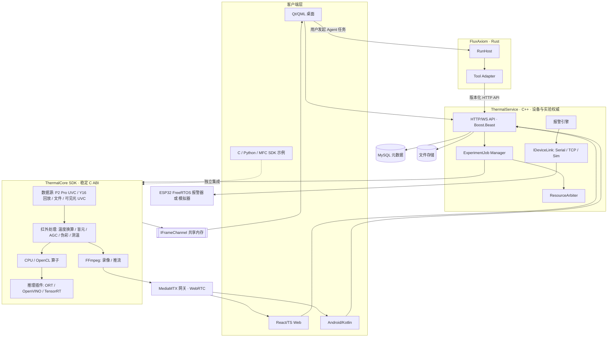
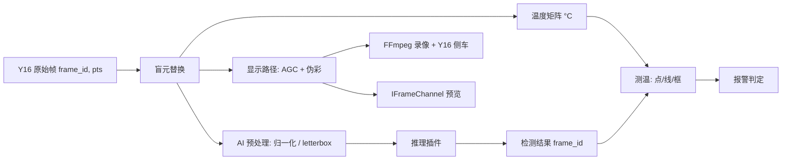
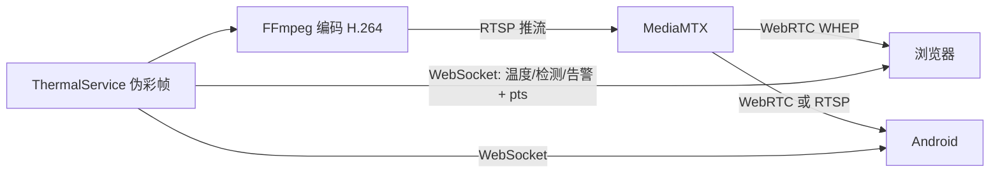
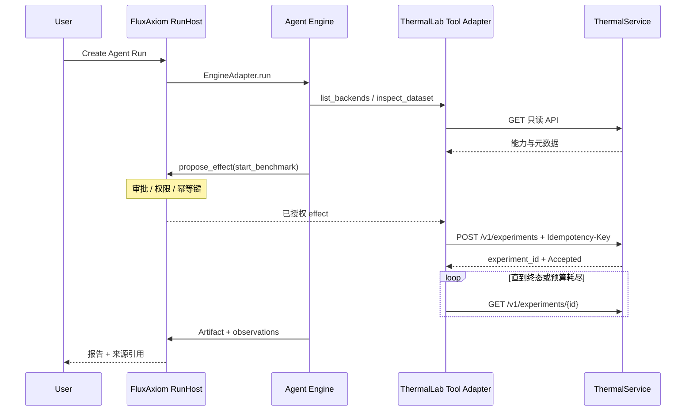
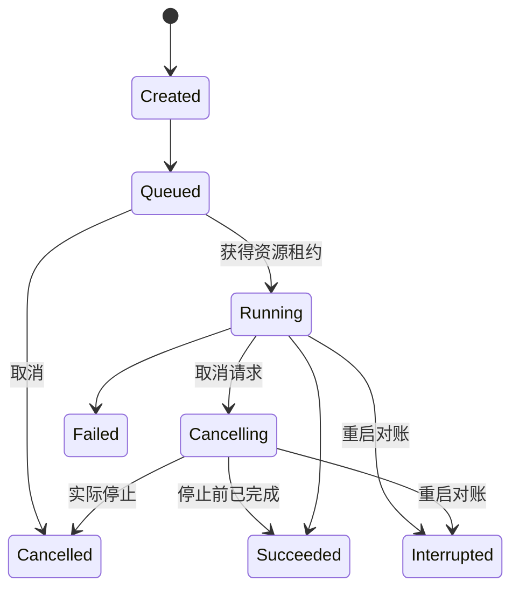
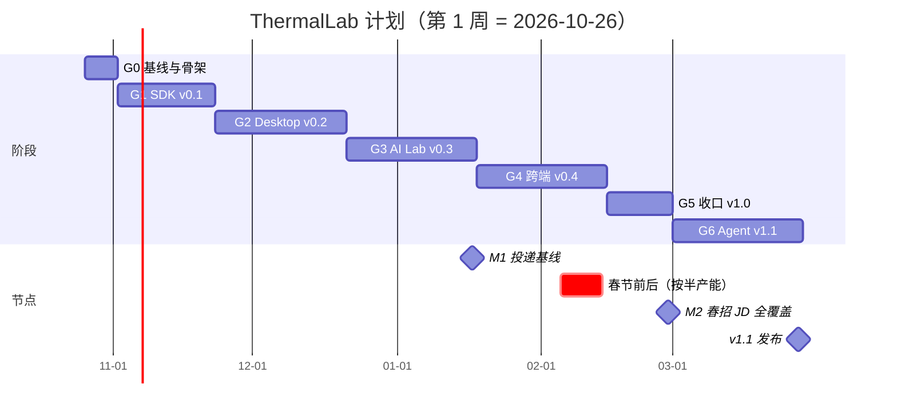

# FluxAxiom ThermalLab 产品需求与系统架构设计 V2.0

Oct 24, 2026 · @Sam

## 0. 修订说明与执行摘要

V2.0 把项目主线拉回红外热像，在春招里程碑（2027-02-28）完成 JD 全覆盖并发布 v1.0，Agent 集成作为 v1.1 在 2027-03-28 前完成。

- 文档类型：PRD + SDD + 模块边界 + 开发及验收计划
- 状态：设计基线 V2.0（拟实施，非已完成），取代 V1.0（EdgeLab）
- 项目定位：跨平台红外热像 SDK 与 Qt/QML 客户端，含多后端边缘 AI 推理、性能实验与 Agent 智能实验
- 目标岗位：睿创微纳·应用软件工程师（上位机方向）；兼顾 Agent/Harness 工程能力
- 已有硬件：Jetson Orin（ARM64 主目标与 TensorRT 平台）、ESP32 开发板；InfiRay P2 Pro 在 G0 确认

**一句话产品定义**：用户在 Windows/Linux 桌面或 Jetson Orin 上接入红外热像仪（或回放其 16-bit 原始数据），实时看到伪彩画面、测温结果和 AI 检测；可以录像、远程查看、联动 ESP32 报警器，并在固定样本上复现三推理后端的性能实验；之后可让 FluxAxiom Agent 按授权执行实验，生成带证据的报告。

### 0.1 V1.0 → V2.0 主要变更

| # | 主题 | V1.0 | V2.0 | 原因 |
| --- | --- | --- | --- | --- |
| 1 | 产品主线 | 通用边缘 AI 视频 Benchmark，明确不做红外 | 红外为一等公民：Y16 原始数据、AGC、伪彩、测温、报警；通用视频源保留 | 对准岗位业务（热像仪 PC 客户端与二次开发 SDK） |
| 2 | 计划与版本 | 20 周，v1.0 = Agent 集成 | M2 春招里程碑完成 JD 全覆盖 = v1.0；Agent = v1.1 | JD 优先，Agent 为加分 |
| 3 | FluxAxiom | 视为外部依赖风险，可阻塞 G5 | 同一作者并行推进，只按技术先后顺序衔接 | 已确认无延期风险 |
| 4 | 本机预览 | 跨进程帧通道未定义 | `IFrameChannel`：G2 进程内实现，G4 换共享内存环形缓冲，渲染层不改 | 补架构缺口 |
| 5 | GPU 资源 | 未定义 | `ResourceArbiter` 资源租约，Benchmark 默认独占 | 防止测量被实时推理污染 |
| 6 | 推理插件 | C++ 接口跨动态库 | C 函数表插件 ABI，带 size/version | 与 SDK ABI 原则一致 |
| 7 | Web/Android 视频 | RTSP 直接适配 Web | MediaMTX 网关转 WebRTC（WHEP）；温度与检测叠加走 WebSocket，按 frame\_id 对齐 | 浏览器不能播放 RTSP |
| 8 | OpenGL | 独立 OpenGL 程序 | 产品主路径 QSG 着色器（伪彩、等温线、叠加）+ 强制 OpenGL 后端的原生 GL 上传实验 | 证据进入产品本身 |
| 9 | ARM64 | RK3588/Jetson 任选 | Jetson Orin 为唯一主目标：TensorRT、交叉编译、目标机运行 | 已有硬件 |
| 10 | ESP32 | 设备模拟，无业务角色 | 报警执行器 + 心跳 + 延迟探针；同协议软件模拟器供 CI 与无硬件开发 | 有硬件且保留模拟接口 |
| 11 | 实验状态 | 无取消中状态 | 增加 `Cancelling` | 取消是异步请求 |
| 12 | 门禁规则 | Blocked 是否阻塞阶段不明确 | Blocked 不阻塞阶段推进，但阻止对应 JD 覆盖声明 | 消除歧义 |
| 13 | 许可证 | 未涉及 | 禁用 AGPL 模型；FFmpeg 用 LGPL 配置；发布清单含许可证 | 公开仓库合规 |
| 14 | 名称 | EdgeLab | ThermalLab（可再定） | 体现红外主线 |

### 0.2 架构约束（代码评审按此检查）

1. **核心产品独立于 Agent**：没有 FluxAxiom、没有云端 LLM 时，SDK、桌面、测温、录像、推理、Benchmark 全部正常。
2. **单一执行所有者**：设备、帧缓存、GPU 上下文、推理执行由 C++ 运行时拥有。同一设备同一时刻只有一个所有者：G1–G3 是桌面进程，G4 起是 ThermalService。
3. **红外数据保真**：原始 Y16 与温度矩阵贯穿管线，8-bit 伪彩只是显示产物。测温、报警、AI 输入都基于原始数据或明确标注的派生数据。
4. **控制面与数据面分离**：帧走 `IFrameChannel` 或媒体流；控制、结果、告警、实验元数据走 API；高频帧绝不写入 durable event。
5. **双状态域**：`ExperimentJob`（C++，MySQL 权威）和 `Run/Attempt`（FluxAxiom，SQLite 权威）只通过关联 ID 关联。
6. **SDK 先于 UI，契约先于跨端**：C ABI、插件 ABI、OpenAPI、设备协议都版本化，先冻结再实现。
7. **业务逻辑只写一份**：温度换算、报警判定、前后处理只在 C++ SDK 中实现，各端只负责展示。
8. **证据验收**：代码、测试、性能数据、跨平台包、运行录屏、复现环境齐备才算完成。

### 0.3 范围诚实边界

本项目追求 JD 技术项的实践覆盖。一个个人项目不等于“多个完整项目的维护经验”，也不能直接推导为“精通”。面试中表述为“个人主导设计并完成的完整项目”，不包装团队规模。

## 1. 产品定位

ThermalLab 模拟热像仪厂商真实的软件交付形态：给客户的 PC 客户端，加上给集成商的二次开发 SDK，再叠加边缘 AI 与实验能力。

### 1.1 目标用户与价值

| 用户角色 | 主要问题 | ThermalLab 提供的能力 |
| --- | --- | --- |
| 热像仪终端用户（巡检、安防、工业） | 需要直观看温度、设报警、留证据 | 实时伪彩、点/线/框测温、高低温追踪、报警联动、录像截图 |
| SDK 集成商（客户的软件工程师） | 需要在自己的 C/C#/Python/MFC 程序里取流、测温 | 稳定 C ABI、Python 绑定、MFC/C 示例、版本兼容说明 |
| 边缘 AI / 算法工程师 | 红外模型在不同后端的速度和精度难以复现对比 | 统一前后处理、三原生后端插件、固定样本 Benchmark |
| 运维 / 设备管理员 | 无法远程看画面和告警 | Web/Android 远程画面、温度、报警、历史记录 |
| Agent 系统使用者 | 复杂实验需要反复手动操作，缺少审计 | 自然语言发起受控实验，结果可追溯到原始数据 |

### 1.2 标准用户故事

**故事 A：实时测温与 AI 检测（核心闭环）**

1. 插上 P2 Pro（或选择一段 Y16 原始录制）打开桌面客户端。
2. 选择伪彩方案和 AGC 模式，设置发射率、反射温度、距离参数。
3. 画面上放置测温点、线、框，看到实时最高/最低/平均温度和高低温游标。
4. 打开 AI 检测（人、车），检测框上显示框内最高温。
5. 设置报警规则（例如框内最高温 > 60°C 持续 2 s），触发时界面告警、写入数据库，并驱动 ESP32 报警器。
6. 一键录像（伪彩视频 + 原始 Y16 侧车文件）和截图（带温度矩阵的辐射截图）。

**故事 B：Jetson 三后端对照**

1. 选择同一份 ONNX 模型、同一份红外数据集、同一套前后处理参数。
2. 在 Jetson Orin 上依次运行 ONNX Runtime（CPU）、OpenVINO（ARM CPU）、TensorRT（GPU，FP32/FP16/INT8）。
3. 记录硬件、JetPack、各 Runtime 版本、精度、预热与测量次数、样本数、功耗模式。
4. 导出 P50/P95 时延、吞吐、资源占用、检测输出差异（mAP 或与参考输出的偏差）；不同设备、不同精度只做条件化对比。

**故事 C：远程查看与报警联动**

1. ThermalService 在 Jetson 上运行，接 P2 Pro。
2. 浏览器和 Android 同时打开，看到低延迟实时画面（WebRTC）和同步的温度、检测叠加层。
3. 报警触发时，手机收到通知，ESP32 蜂鸣/亮灯；ESP32 掉线后重连，报警状态由服务端对账恢复。

**故事 D：Agent 自动实验（v1.1）**

1. 用户输入：“在固定红外样本集上做三后端对照，并总结最佳配置。”
2. FluxAxiom 创建 `Run`，用只读工具收集环境，提出实验计划。
3. 有副作用的操作走审批与权限检查；ThermalService 创建 `ExperimentJob`。
4. Agent 跟踪结果并生成报告，附 `RunId`、`ExperimentId`、数据集哈希和原始结果引用。
5. Agent 异常退出时，实验不被默认中断；恢复后通过关联 ID 查询真实状态。

### 1.3 明确不做

- 不实现相机固件、快门 NUC 或厂商私有标定算法；以相机输出数据为准，软件侧只做盲元替换和可选的两点校正实验。
- 不承诺测温精度达到计量级，温度换算以相机文档和开源参考实现为依据，并标注误差来源。
- 不做模型训练平台。红外检测模型的离线微调属于“模型准备”，不是产品功能。
- 不做分布式 GPU 集群、多租户 SaaS。
- 不把设备控制默认授权给 LLM，不自动执行未审批的副作用操作。
- 不承诺任意设备零拷贝、任意平台可运行 TensorRT 或 OpenCL。
- 不在本项目中重写 FluxAxiom 的 RunHost、Agent Loop 或持久化语义。

## 2. 产品功能清单（需求基线）

功能按两个里程碑分档：M1 是可以开始投递的基线，M2 是 JD 全覆盖的 v1.0，二者都是硬性目标。

| 优先级 | 含义 | 截止 |
| --- | --- | --- |
| **M1** | 投递基线必须项：SDK、红外处理、桌面、录像、三后端、性能报告 | 2027-01-17（第 12 周末） |
| **M2** | JD 全覆盖必须项：服务、跨端、MFC、嵌入式、交叉编译、发布 | 2027-02-28（第 18 周末） |
| **SHOULD** | v1.0 争取完成，未完成不阻塞发布 | 2027-02-28 |
| **V1.1** | Agent 集成阶段 | 2027-03-28（第 22 周末） |

阶段编号 G0–G6 见第 9 章。

### 2.1 桌面客户端（Qt 6 / QML）

| ID | 优先级 | 功能 | 用户可观察结果 | 首次阶段 |
| --- | --- | --- | --- | --- |
| UI-01 | M1 | QML 主窗口与导航 | 实时、测温、录像、实验、模型、设备、历史、设置页面 | G2 |
| UI-02 | M1 | QML/C++ 数据绑定 | `Q_PROPERTY`、`QAbstractListModel`、信号槽、跨线程更新 | G2 |
| UI-03 | M1 | 实时与回放控制 | 播放、暂停、逐帧、拖动，时间戳与进度一致 | G2 |
| UI-04 | M1 | 测温交互 | 点、线、框可拖拽编辑，实时显示 max/min/avg 与高低温游标 | G2 |
| UI-05 | M1 | 伪彩、AGC、等温线参数面板 | 切换即时生效，参数随录像与截图保存 | G2 |
| UI-06 | M1 | AI 检测叠加 | 检测框按 `frame_id` 对齐，显示框内最高温 | G3 |
| UI-07 | M1 | 实验任务面板 | 创建、排队、运行、取消中、完成、失败状态正确呈现 | G3 |
| UI-08 | M1 | 性能面板 | FPS、P50/P95、丢帧、CPU/GPU 占用 | G3 |
| UI-09 | M2 | 报警规则与告警列表 | 规则可配置；告警关联 trace\_id 与诊断日志 | G3 |
| UI-10 | M2 | Jetson 上运行客户端 | 桌面会话或 eglfs 下画面、测温、检测正常 | G4 |
| UI-11 | SHOULD | 双路查看（热像 + 可见光） | 两路独立控制，可并排显示 | G4 |

### 2.2 C++ SDK、红外处理、媒体与图形

| ID | 优先级 | 功能 | 验收输出 | 首次阶段 |
| --- | --- | --- | --- | --- |
| SDK-01 | M1 | 独立 C++ 动态库 + C ABI | 纯 C 程序可链接使用，不依赖 Qt | G1 |
| SDK-02 | M1 | 不透明句柄、错误码、版本协商、内存所有权 | 文档、负向测试、版本样例 | G1 |
| SRC-01 | M1 | `ReplaySource`：Y16 原始录制回放 | raw + JSON 侧车格式；Golden 帧哈希一致 | G1 |
| SRC-02 | M1 | `ThermalUvcSource`：P2 Pro 采集 | 解析图像帧与温度帧；实机运行记录 | G1 |
| SRC-03 | M1 | `FileSource`：FFmpeg 解复用与解码 | MP4/H.264 样本解码、定位正确 | G2 |
| SRC-04 | M2 | 通用 UVC 可见光摄像头 | 实机采集；同时作为延迟探针的被测源 | G2 |
| THM-01 | M1 | 温度换算 | raw→°C；发射率、反射温度、距离、环境温度参数化；单测覆盖边界 | G1 |
| THM-02 | M1 | 点/线/框测温与高低温追踪 | max/min/avg 及位置；与参考实现对比 | G1 |
| THM-03 | M1 | AGC：线性、直方图均衡、平台直方图 | 输出与 Golden 图像在容差内一致 | G1 |
| THM-04 | M1 | 伪彩 LUT（≥ 6 种）与等温线 | CPU 参考实现 + GPU 着色器实现一致 | G1/G2 |
| THM-05 | M1 | 盲元检测与替换 | 注入坏点的样本可被检测和修复 | G1 |
| THM-06 | M1 | 报警判定引擎 | 阈值、持续时间、迟滞；只在 SDK 实现一份 | G1 |
| THM-07 | M1 | 辐射截图与原始数据录制 | PNG + 温度矩阵；Y16 侧车与视频时间戳对齐 | G2 |
| THM-08 | SHOULD | 两点非均匀性校正实验 | 用黑体或均匀面替代物做前后对比 | G5 |
| IMG-01 | M1 | CPU 图像算子 | resize、色彩转换、归一化、叠加 | G1 |
| IMG-02 | M1 | OpenCL 加速 | AGC、伪彩、盲元、预处理的 kernel；与 CPU 容差比对和时延对比 | G2 |
| RND-01 | M1 | Qt Quick 纹理渲染 | `QQuickRhiItem` / 场景图纹理；说明图形后端、线程边界、上传策略 | G2 |
| RND-02 | M1 | GLSL 着色器进入产品主路径 | `QSGMaterialShader` 完成伪彩 LUT、等温线、检测框叠加 | G2 |
| RND-03 | M2 | 原生 OpenGL 实验 | 强制 OpenGL 后端下，`glTexSubImage2D` 与 PBO 上传对比；各图形后端渲染耗时对比 | G2/G5 |
| CH-01 | M1 | `IFrameChannel` 进程内实现 | 渲染层只依赖接口 | G2 |
| CH-02 | M2 | `IFrameChannel` 共享内存实现 | 跨进程预览，渲染层代码不改 | G4 |
| MED-01 | M1 | FFmpeg 编码录像 | 独立播放器可打开；PTS 单调、时长正确 | G2 |
| MED-02 | M2 | 音频：语音备注轨与音视频同步 | 录像可附麦克风语音备注；解码、重采样、重封装；A/V 偏移可测 | G2 |
| MED-03 | M2 | 推流与远程播放 | 推流至 MediaMTX；Web 经 WebRTC 播放；端到端时延记录 | G4 |
| MED-04 | M2 | 硬件编解码 | x86（NVENC/QSV/Media Foundation 视设备）与 Jetson（视型号）A/B 对比 | G5 |
| PY-01 | M2 | Python SDK 绑定 | pybind11、pytest、Benchmark 分析脚本 | G3 |
| MFC-01 | M2 | MFC 示例 | MSVC 独立编译，调用 C API 取流、测温 | G4 |

### 2.3 AI 推理与 Benchmark

| ID | 优先级 | 功能 | 验收输出 | 首次阶段 |
| --- | --- | --- | --- | --- |
| INF-01 | M1 | 插件 ABI（C 函数表）与发现加载 | 缺失、版本不兼容插件有明确错误 | G3 |
| INF-02 | M1 | ONNX Runtime 原生后端 | x86 与 Jetson CPU 真实推理、结果回归 | G3 |
| INF-03 | M1 | OpenVINO 原生后端 | x86 CPU/iGPU；Jetson ARM CPU | G3 |
| INF-04 | M1 | TensorRT 原生后端 | Jetson Orin 必测；有 x86 NVIDIA GPU 时加测 | G3 |
| INF-05 | M1 | 统一前后处理 | Y16 到模型输入的归一化策略、letterbox、NMS 一致性测试 | G3 |
| INF-06 | M1 | 模型元数据 | 文件哈希、IO shape、数据类型、后端配置可查询 | G3 |
| INF-07 | M1 | 红外检测模型准备 | 许可证合规模型（YOLOX/RT-DETR 等 Apache-2.0）；离线微调过程有记录 | G0/G3 |
| RES-01 | M1 | `ResourceArbiter` 资源租约 | Benchmark 独占加速器；并发负载写入环境清单 | G3 |
| BEN-01 | M1 | 固定工作负载 Benchmark | 预热、迭代、重复次数、P50/P95、吞吐 | G3 |
| BEN-02 | M1 | 对照报告导出 | JSON + CSV + Markdown | G3 |
| BEN-03 | M2 | FP32/FP16/INT8 对比 | INT8 校准集、精度变化有记录 | G5 |
| BEN-04 | SHOULD | Jetson 功耗模式对照 | 不同 nvpmodel 档位下的时延与功耗 | G5 |

### 2.4 服务、存储、跨端与嵌入式

| ID | 优先级 | 功能 | 验收输出 | 首次阶段 |
| --- | --- | --- | --- | --- |
| SVC-01 | M2 | ThermalService（Boost.Asio/Beast） | 健康检查、控制接口、事件订阅 | G3 骨架 / G4 |
| SVC-02 | M2 | OpenAPI 契约与错误语义 | TS/Kotlin 客户端生成；服务端契约测试 | G4 |
| SVC-03 | M2 | 鉴权 | 本机令牌、局域网配对、read/execute 权限范围 | G4 |
| DB-01 | M1 | MySQL 元数据存储 | 迁移、索引、查询、重启后数据保留 | G3 |
| DB-02 | M1 | 媒体、模型、报告文件单独存储 | 数据库只存元数据与内容引用 | G3 |
| WEB-01 | M2 | React + TypeScript Web 端 | 实时画面、温度与检测叠加、告警、实验与报告 | G4 |
| AND-01 | M2 | Android（Kotlin）客户端 | 实时画面、告警通知、历史；契约测试通过 | G4 |
| EMB-01 | M2 | ESP32 + FreeRTOS 报警执行器 | 任务、队列、串口/Wi-Fi 协议、心跳、掉线恢复真机实测 | G4 |
| EMB-02 | M2 | 设备协议软件模拟器 | 与固件同一协议；支持丢包、错帧、延迟、重启注入；CI 使用 | G4 |
| EMB-03 | M2 | 延迟探针 | ESP32 + 光敏元件测量可见光链路屏到屏时延 | G5 |
| EMB-04 | SHOULD | 二轴云台或环境温湿度传感器 | 云台跟随检测目标，或环境温度参与测温补偿 | G5 |
| BUILD-01 | M1 | Windows + Linux CI | 两平台构建与测试 | G0 |
| BUILD-02 | M1 | SDK 交叉编译到 Jetson | aarch64 构建 + 目标机 smoke test | G1 |
| BUILD-03 | M2 | Qt 应用交叉编译到 Jetson | 目标机启动、画面正常 | G4 |
| BUILD-04 | M2 | 安装包 | Windows 安装器、Linux AppImage/deb、Jetson deb | G5 |
| QA-01 | M1/M2 | 多层自动化与性能治理 | 单元、集成、契约、E2E、回归、性能报告 | 全程 |
| AI-DEV-01 | M2 | AI 跨端开发实践与审计 | 生成记录、人工改动、测试拦截缺陷、复盘 | G4/G5 |

### 2.5 Agent 集成

| ID | 优先级 | 功能 | 验收输出 | 首次阶段 |
| --- | --- | --- | --- | --- |
| AGT-01 | V1.1 | FluxAxiom 只读工具适配 | 查询设备、实验、指标、配置 | G6（API 稳定后可提前） |
| AGT-02 | V1.1 | Agent 发起 Benchmark 的受控执行 | 审批、幂等、防重、状态对账 | G6 |
| AGT-03 | V1.1 | Agent 生成对照报告 | 结论可追溯到实验、样本、结果、Run | G6 |

### 2.6 发布版本

| 版本 | 日期 | 内容 |
| --- | --- | --- |
| v0.1 SDK | 2026-11-22 | Y16 回放、P2 Pro 采集、红外处理与测温、C API、Jetson smoke test |
| v0.2 Desktop | 2026-12-20 | Qt/QML 实时测温、GPU 着色器、OpenCL、FFmpeg 录像与音频 |
| v0.3 AI Lab（M1） | 2027-01-17 | 三后端插件、Benchmark、MySQL、服务骨架、Python 绑定、性能报告 |
| v0.4 Cross-device | 2027-02-14 | 共享内存预览、OpenAPI、Web/Android、MFC、ESP32、Jetson 上的 Qt 应用 |
| v1.0 JD 全覆盖（M2） | 2027-02-28 | INT8、硬件编解码、延迟探针、安装包、文档、演示视频 |
| v1.1 Agent-enabled | 2027-03-28 | FluxAxiom 集成、审批、审计、故障演练 |

## 3. 系统总体架构

ThermalService 是设备与实验的唯一权威；桌面经共享内存拿预览帧，远程端经 MediaMTX 拿视频流，控制和结果统一走 API。

### 3.1 逻辑架构



SDK 示例直接链接 SDK 属于独立集成场景，使用回放数据或独占设备，不与运行中的 ThermalService 争抢同一台相机。

### 3.2 红外帧数据流



帧级运行规则：

- `Frame` 至少包含 `source_id`、`frame_id`、`pts_ns`、宽高、像素格式（含 `Y16`）、stride、数据所有权描述，以及红外元数据（测温参数、相机温度、快门状态）。
- 显示路径可以在 GPU 着色器里做 AGC 和伪彩；测温、报警和 AI 输入始终基于原始 Y16 或温度矩阵，不从 8-bit 伪彩反推。
- `FrameResult` 显式关联 `frame_id`，不依赖“最新一帧”隐式对齐。
- 队列有界。实时预览可丢旧帧并计数；离线 Benchmark 不丢样本，完整计数。
- UI 主线程不做解码、推理、GPU 同步或数据库写入。
- 采集、处理、推理、渲染、编码、存储各自打点，报告写清测量口径。未经实测不宣称零拷贝。

### 3.3 本机预览通道（`IFrameChannel`）

渲染层只依赖 `IFrameChannel` 接口，G2 用进程内实现，G4 换成共享内存实现，QML 和渲染代码不改。

| 项目 | 设计 |
| --- | --- |
| 接口 | `publish(FrameView)`；`acquire_latest() → FrameLease`；`release(FrameLease)`；`stats()` |
| G2 实现 | `InProcFrameChannel`：环形槽位 + 原子序号，同进程零依赖 |
| G4 实现 | `ShmFrameChannel`：Windows 命名文件映射，Linux `memfd`/POSIX shm；固定 N 个槽位（默认 4） |
| 槽位头 | 魔数、协议版本、槽位序号（seqlock 风格读前读后比对）、`frame_id`、`pts_ns`、格式、尺寸、stride |
| 背压 | 写端从不阻塞，覆盖最旧槽位；读端只取最新完整帧；丢帧双端计数 |
| 建立连接 | 客户端经 API 订阅预览，服务端返回共享内存名称和一次性令牌；断开后槽位自动回收 |
| 数据内容 | 热像：Y16 原始帧（着色器做伪彩）；可见光：NV12/RGBA |
| 带宽 | P2 Pro 约 256×192×2 B × 25 Hz ≈ 2.5 MB/s（帧率 G0 实测确认），1080p RGBA 30 fps 约 250 MB/s；按后者设计 |

### 3.4 远程视频与叠加



- 视频与叠加数据分两路，客户端按 PTS 与 RTP 时间戳映射对齐（浏览器用 `requestVideoFrameCallback`）。对齐误差需实测记录，做不到精确对齐时标注为“近似叠加”。
- WebSocket 只承载状态、温度、检测、告警，不承载原始帧。
- 断线后客户端以 `GET` 权威快照补齐，流消息不是唯一事实来源。

### 3.5 Agent 实验流（v1.1）



有副作用的 Agent 工具依赖 FluxAxiom 的 Effect Gateway（`propose_effect`）。该能力在 FluxAxiom 仓库内并行开发，G6 开始前完成即可；G6 之前 Agent 工具只读，实验由人工或 UI 发起。

## 4. 模块边界与所有权

每个模块只有一个“唯一负责”，状态权威不跨模块重复，这是后续评审最常引用的一章。

### 4.1 模块职责表

| 模块 | 语言/技术 | 唯一负责 | 明确不负责 | 对外接口 |
| --- | --- | --- | --- | --- |
| `thermalcore` SDK | C++17 / CMake | 数据源抽象、帧结构、处理管线、错误定义、C ABI | GUI、HTTP、Agent 生命周期 | C API + 内部 C++ 接口 |
| `thermal-proc` | C++ | 温度换算、盲元、AGC、伪彩 LUT、测温、报警判定 | 显示、存储 | `IThermalProcessor`、`IAlarmEngine` |
| `edge-media` | C++ / FFmpeg | 解复用、解码、编码、音频、PTS、录像、推流 | 业务授权、实验状态 | `IMediaSource`、`IRecorder`、`IStreamer` |
| `edge-image` | C++ / OpenCL | CPU/OpenCL 算子与数值一致性 | 模型调度、UI | `IImageProcessor` |
| `edge-infer` | C++ / ORT / OpenVINO / TensorRT | 插件加载、前后处理、推理、兼容性检测 | Agent 决策、数据库写入 | 插件 C 函数表 |
| `frame-channel` | C++ | 预览帧跨线程/跨进程传递、背压、计数 | 帧内容解释 | `IFrameChannel` |
| `thermal-service` | C++ / Boost.Asio / Beast | 业务 API、`ExperimentJob`、设备所有权、资源仲裁、持久化协调 | LLM 调用、FluxAxiom 状态 | HTTP/OpenAPI + WebSocket |
| `device-link` | C++ | ESP32 通信、协议编解码、心跳、重连 | 报警规则判定 | `IDeviceLink`（Serial / TCP / Sim） |
| `thermallab-desktop` | C++ / Qt 6 / QML | 交互、可视化、着色器渲染、本地控制器 | 业务状态权威、推理决策 | Service API + `IFrameChannel` |
| `thermallab-web` | TypeScript / React | 远程查看、告警、实验查询 | 加载 SDK、定义业务规则 | 生成的 TS 客户端 |
| `thermallab-android` | Kotlin | 远程查看与通知 | 直接操作设备句柄 | 生成的 Kotlin 客户端 |
| `firmware-esp32` | C / FreeRTOS | 报警执行、心跳、延迟探针、协议响应 | 视频、推理、报警判定 | 设备协议 v1 |
| `device-sim` | C++ 或 Python | 按设备协议模拟 ESP32，注入故障 | 真实时序验证 | 设备协议 v1 |
| `agent-adapter` | Rust | 业务 API 映射为 Agent 工具、幂等、对账 | 实时处理、设备所有权 | FluxAxiom Engine/Tool API |
| `FluxAxiom` | Rust / Tokio / SQLite | Run/Attempt、预算、durable event、审批 | 逐帧调度、实验指标权威 | `EngineAdapter`、`HostPort` |
| `thermallab-store` | C++ / MySQL + 文件系统 | 实验、数据集、设备、告警、指标元数据；媒体与模型引用 | Agent 运行审计 | Repository 接口 |

### 4.2 状态模型

**A. 数据源状态（C++）**：`Closed → Opened → Streaming ⇄ Paused → Stopped / Failed`。热像源额外暴露快门状态（NUC 进行中时帧标记为不可测温）。

**B. 实验任务状态（C++，MySQL 权威）**



- 取消是请求，最终以真实终态为准；`Cancelling` 可能落到 `Succeeded`。
- `Interrupted` 是重启对账后判定的非正常结束，不是自动重试承诺。只有可证明幂等时才按明确策略重试。
- 持久化 `experiment_id`、`spec_hash`、开始/结束时间、输出引用、错误码、资源租约记录。

**C. 设备连接状态（ESP32）**：`Disconnected → Handshaking → Online → Degraded（心跳超时） → Disconnected`。重连后服务端重新下发当前报警状态，以服务端为准对账。

**D. Agent 运行状态（FluxAxiom，SQLite 权威）**：沿用 `Run/Attempt/Session/Event/Artifact`。一个 Run 可关联多个 `experiment_id`；实验也可以没有 RunId。

**禁止**：用 `RunId` 充当 `ExperimentId`；把逐帧事件写成 durable Agent event；让 Rust 从 MySQL 推导 Agent 终态；让 ESP32 自行判定报警。

### 4.3 存储边界

| 数据 | 权威存储 | 原因 |
| --- | --- | --- |
| 视频、Y16 原始录制、辐射截图、模型二进制 | 文件系统（内容哈希 + manifest） | 大块数据不进关系库 |
| 实验参数、历史、设备、告警、测温记录、指标 | MySQL | 可查询、可筛选、可聚合 |
| 实验执行状态 | MySQL `experiments` | 服务是执行权威 |
| Agent Run/Attempt、观察、审批事件 | FluxAxiom SQLite | 沿用 Harness 语义 |
| Agent 报告 Artifact | FluxAxiom blob，带业务引用 | 与 Agent 执行证据关联 |

跨 MySQL 与 SQLite 没有分布式事务：服务端幂等键 + 返回 `experiment_id` + 定期对账 + 重复事件幂等处理；必要时保留 `Unknown`，不宣称 exactly-once。测温记录按 1 Hz 汇总写入，不逐帧写库。

### 4.4 进程边界与演进

| 阶段 | 设备所有者 | 桌面如何取帧 | 说明 |
| --- | --- | --- | --- |
| G1 | SDK 示例进程 | 无桌面 | 纯 C/C++ 数据路径 |
| G2–G3 | 桌面进程（内嵌 SDK） | `InProcFrameChannel` | SDK 访问封装在 `ThermalClient` 门面后面 |
| G3 | 服务骨架只管实验 | 同上 | 实验与预览暂不共用设备，Benchmark 用数据集文件 |
| G4 起 | ThermalService | `ShmFrameChannel` | 桌面、Web、Android 都只发控制请求 |

`ThermalClient` 门面有两个实现：`InProcClient`（G2–G3）和 `RemoteClient`（G4 起）。迁移时 QML 页面与 ViewModel 不改，只切换实现。

### 4.5 资源仲裁（`ResourceArbiter`）

- 资源单位：每块加速器（CPU 核组、x86 GPU、Jetson GPU、DLA 若启用）一个租约。
- 实时推理持共享租约；Benchmark 申请独占租约，申请时实时推理暂停或 Benchmark 排队（由用户策略决定，默认排队）。
- 每个实验的 `environment_manifest` 记录运行期间的并发负载、功耗模式、温度降频事件（Jetson 读 tegrastats）。
- 租约有超时和持有者记录，服务重启时随实验对账一并清理。

## 5. C++/Rust 职责与接口契约

C++ 拥有一切确定性执行（设备、媒体、红外、推理、实验），Rust/FluxAxiom 只负责 Agent 规划、预算、审批和审计；两者之间只走版本化 HTTP API。

### 5.1 职责决策矩阵

| 关注点 | C++ | Rust/FluxAxiom | 理由 |
| --- | --- | --- | --- |
| 采集、解码、红外处理、GPU 资源 | 负责 | 否 | 媒体生态、数据布局、实时性能 |
| 模型加载、推理、性能打点 | 负责 | 否 | 原生 SDK 集成，控制测量口径 |
| 设备读写、串口、ESP32 | 负责 | 否 | 单一设备所有者，收紧副作用 |
| 实验队列与状态 | 负责 | 调用与观察 | 结果独立于 LLM 存在 |
| 任务规划、工具选择、模型调用、预算 | 否 | 负责 | Harness 核心价值 |
| 审批 / Effect Gateway | 执行前二次校验 | 发起与审批 | Agent 不绕过权限 |
| 报告组织与证据引用 | 提供结构化原始指标 | 组织报告 | 事实计算与语言推理解耦 |

### 5.2 SDK C ABI 原则

- 对外只暴露 `extern "C"`；内部使用 RAII、`std::unique_ptr`，有真实共享所有权时才用 `std::shared_ptr`。
- 公共 API 不暴露 `std::string`、STL 容器、C++ 异常、Qt 类型或编译器相关布局；异常在边界内转为错误码。
- 结构体以 `size` 与 `version` 字段协商扩展；错误码命名稳定、语义有文档。
- 帧数据明确“拷贝 / 借用 / 引用计数”三选一；借用指针的有效期写进文档；回调线程有文档和线程安全测试。
- 最小函数集（G1 冻结）：`tl_get_version`、`tl_create`、`tl_open_source`、`tl_next_frame`、`tl_release_frame`、`tl_get_temperature_map`、`tl_measure_roi`、`tl_destroy`、`tl_last_error_message`。
- Windows MSVC、Linux GCC/Clang、Jetson aarch64 分别构建。C ABI 降低跨语言风险，但不保证任意编译器、CRT、位数组合无条件兼容。

### 5.3 推理插件 ABI

插件以动态库形式加载，入口只有一个 C 函数，返回带版本的函数表：

```c
typedef struct tl_backend_plugin_v1 {
  uint32_t size;            /* sizeof(tl_backend_plugin_v1) */
  uint32_t abi_version;     /* TL_PLUGIN_ABI_VERSION */
  const char* backend_id;   /* "ort" | "openvino" | "tensorrt" */
  tl_status (*probe)(tl_backend_caps* out_caps);
  tl_status (*load_model)(const tl_model_desc* desc, tl_backend_session** out);
  tl_status (*infer)(tl_backend_session* s, const tl_tensor* in, uint32_t n_in,
                     tl_tensor* out, uint32_t n_out);
  void      (*unload)(tl_backend_session* s);
  const char* (*runtime_version)(void);
} tl_backend_plugin_v1;

TL_PLUGIN_EXPORT const tl_backend_plugin_v1* tl_get_backend_plugin(uint32_t host_abi);
```

- 宿主按 `abi_version` 和 `size` 判断兼容性，不兼容返回 `UnsupportedBackend` 并写明原因。
- 插件内部可以随意使用 C++；张量内存由宿主分配、插件借用，所有权规则与 SDK 一致。
- `probe` 报告设备、精度、动态 shape 支持；后端 Runtime 缺失时插件加载失败但宿主不崩溃。

### 5.4 服务 API 契约草案

| 操作 | 端点（拟定） | 权限 / 幂等 | 返回 |
| --- | --- | --- | --- |
| 健康与版本 | `GET /v1/health` | 无副作用 | 版本、状态 |
| 设备与数据源 | `GET /v1/devices` | read | 相机、ESP32、连接状态 |
| 订阅本机预览 | `POST /v1/preview/sessions` | read，仅本机 | 共享内存名、一次性令牌 |
| 远程流信息 | `GET /v1/streams` | read | WHEP 地址、编码参数 |
| 实时测温与 ROI | `GET/PUT /v1/rois` | 读 read，写 execute | ROI 定义与当前温度 |
| 报警规则与记录 | `GET/PUT /v1/alarm-rules`、`GET /v1/alarms` | 读 read，写 execute | 规则、告警历史 |
| 后端与模型 | `GET /v1/backends`、`GET /v1/models`、`GET /v1/datasets` | read | 能力、哈希、shape |
| 发起实验 | `POST /v1/experiments` | execute + `Idempotency-Key` | `experiment_id`、状态 |
| 查询 / 取消实验 | `GET /v1/experiments/{id}`、`POST /v1/experiments/{id}/cancel` | read / execute + 幂等 | 状态、进度、指标 |
| 实验结果 | `GET /v1/experiments/{id}/results` | read | 配置、指标、内容引用 |
| 事件订阅 | `GET /v1/events`（WebSocket） | read | `seq`、事件类型、关联 ID |

- 错误分类：`InvalidArgument`、`NotFound`、`UnsupportedBackend`、`Conflict`、`PermissionDenied`、`Busy`、`Timeout`、`Internal`。明确哪些可重试；响应带 `request_id` 与稳定错误码，堆栈只进服务端日志。
- C++ Beast 没有成熟的 OpenAPI 服务端代码生成器：服务端手写处理器，以契约测试保证一致；TS 与 Kotlin 客户端由 OpenAPI 生成。

### 5.5 鉴权

| 场景 | 机制 |
| --- | --- |
| 本机桌面 | 用户配置目录下的令牌文件（仅当前用户可读），带 read + execute |
| 局域网 Web/Android | 桌面显示 6 位配对码或二维码，换取设备令牌；默认只有 read，execute 需在桌面确认 |
| Agent Adapter | 默认 read；execute 只能经 G6 审批路径获得单次授权 |
| 传输 | 局域网 HTTPS 自签证书，配对时固定指纹（SHOULD）；不支持公网暴露 |
| 文件路径 | 只允许访问用户授权的数据目录，拒绝路径穿越 |

### 5.6 ESP32 设备协议与模拟接口

ESP32 只执行动作和上报事实，报警判定留在 SDK；真机与模拟器实现同一份协议，宿主侧通过 `IDeviceLink` 无差别使用。

**协议 v1**

- 传输：UART（USB 串口）或 TCP（Wi-Fi），帧格式相同。
- 成帧：COBS 编码，`0x00` 分隔；载荷 = `ver(1) | type(1) | seq(2) | len(2) | body | crc16`。
- 可靠性：命令需 ACK，按 `seq` 幂等；超时重传最多 3 次；心跳 1 Hz，3 s 未收到判定 `Degraded`。

| 消息 | 方向 | 内容 |
| --- | --- | --- |
| `HELLO` / `HELLO_ACK` | 双向 | 协议版本、设备 ID、能力位 |
| `HEARTBEAT` | 设备 → 宿主 | 运行时长、剩余堆、任务栈水位、复位原因 |
| `ALARM_SET` / `ALARM_ACK` | 宿主 → 设备 | 等级、声光模式、持续时间 |
| `PROBE_ARM` / `PROBE_RESULT` | 双向 | 延迟探针触发与结果（微秒） |
| `SENSOR_REPORT` | 设备 → 宿主 | 环境温湿度（可选） |
| `PTZ_SET` / `PTZ_STATE` | 双向 | 云台角度（可选） |
| `ERROR` | 双向 | 错误码与上下文 |

**宿主侧 `IDeviceLink` 实现**

| 实现 | 用途 |
| --- | --- |
| `SerialLink` | 真机 USB 串口 |
| `TcpLink` | 真机 Wi-Fi，或连接独立运行的模拟器 |
| `SimLink` | 进程内模拟，单元测试使用 |

**模拟器 `device-sim`**：独立进程，监听 TCP 或虚拟串口，实现完整协议；可配置传感器数据曲线和探针结果；支持丢包、错 CRC、延迟、乱序、设备重启注入。CI 中所有设备相关集成测试都跑在模拟器上，真机测试作为 G4/G5 的硬件验收。

**固件任务划分（FreeRTOS）**

| 任务 | 优先级 | 职责 |
| --- | --- | --- |
| `probe_task` + GPIO/ADC 中断 | 最高 | 延迟探针时间戳，中断中只记录时间并通知任务 |
| `proto_task` | 高 | 解帧、校验、分发、ACK |
| `comm_task` | 中 | UART / Wi-Fi 收发，经队列与 `proto_task` 交互 |
| `alarm_task` | 中 | 蜂鸣器与 LED 模式 |
| `health_task` | 低 | 心跳、看门狗喂狗、栈水位统计 |

**延迟探针**：ESP32 点亮放在可见光摄像头视野内的 LED，并记录时间；画面经采集、处理、显示后，贴在屏幕上的光敏元件检测到亮度变化，ESP32 再记录时间，两者之差即屏到屏时延，用同一时钟测量，无需对时。长波红外相机看不到 LED，热像链路的时延以软件分段打点为准，文档中注明这一测量边界。

### 5.7 Agent 工具与授权

| Tool | 类别 | 副作用 | G6 前可用 |
| --- | --- | --- | --- |
| `list_backends` / `inspect_model` / `list_datasets` | inspect | 否 | 是 |
| `get_experiment` / `get_metrics` / `get_alarms` | inspect | 否 | 是 |
| `start_benchmark` / `cancel_experiment` | effect | 是 | 否 |
| `set_alarm_rule` / `change_device_config` | effect | 是 | 否 |

有副作用工具的验收前提：

1. `HostPort::propose_effect` 可用，授权来自用户或产品策略，而不是模型文本。
2. ThermalService 再次校验令牌权限，不因 Adapter 声称“已审批”而直接执行。
3. `effect_id` 与 `Idempotency-Key` 在断连、超时、重试后可查询、可对账。
4. 严格区分 `Accepted`、`Succeeded`、`Unknown`。
5. Agent 超时、预算耗尽或崩溃，不等同于实验失败或设备停止。

### 5.8 FluxAxiom 复用与衔接

FluxAxiom 与本项目由同一作者推进，以下是 2026-10-24 核对的 `main` 状态和衔接方式，G6 开工前重新核对。

| 组件 | 当时状态 | ThermalLab 处理方式 |
| --- | --- | --- |
| `agent-contract` | Session/Run/Attempt/Event/Artifact 模型与 Schema | 原样复用 |
| `run-host` | SQLite、状态与事件同事务、blob、`events_after`、`snapshot`、`drive_run` | 直接复用，不复制主机状态库 |
| `engine-api` | `EngineAdapter`、`HostPort`、observe、reserve | 保留抽象，接入业务工具 |
| `engine-custom` | DeepSeek Loop、只读仓库工具与测试 | 抽出可组合工具注册后扩展业务工具，不污染原工具安全边界 |
| `apps/cli` | 仅打印名称；run/status/events/artifacts 待实现 | 按 FluxAxiom P0a 计划在 G6 前完成 |
| `propose_effect` | P0a 返回 `Unsupported` | FluxAxiom P0b Effect Gateway 在 G6 前完成 |

依赖方式：独立仓库，以 Git tag 或 commit 固定依赖，各自 CI。通用 Harness 能力进入 FluxAxiom，ThermalLab 只写业务适配层；只用现有 Engine A 验证业务闭环。

## 6. 技术栈与平台策略

Jetson Orin 是 ARM64 交叉编译、TensorRT、目标机运行的主平台；OpenCL 在 x86 上验收；OpenGL 能力通过产品内的着色器和强制 OpenGL 后端实验来证明。

### 6.1 基线技术栈

| 类别 | 基线选择 | 注意事项 |
| --- | --- | --- |
| 核心语言 | C++17，Rust（沿用 FluxAxiom 工具链），Python 3 | 锁定并记录实际编译器版本 |
| GUI | Qt 6 LTS（≥ 6.8），Qt Quick/QML | `QQuickRhiItem` 需 Qt ≥ 6.7 |
| 构建 | CMake + vcpkg manifest；Cargo；Docker 交叉编译镜像 | 锁文件与 CI 缓存 |
| 媒体 | FFmpeg C API（LGPL 配置）+ MediaMTX | 软件 H.264 编码用 OpenH264，不用 x264 |
| 图形 | Qt Scene Graph / QRhi；QSG 着色器；原生 OpenGL 实验 | 不假设 Qt 一定用 OpenGL 后端 |
| 计算 | OpenCL（x86）+ CPU fallback | Jetson 无官方 OpenCL，见 6.3 |
| AI | ONNX Runtime / OpenVINO / TensorRT 原生插件 | ORT 的 TensorRT EP 不算原生 TensorRT 证据 |
| 网络 | Boost.Asio / Beast | 局域网 HTTPS 自签证书 |
| 数据 | MySQL 8 + 文件系统 | 客户端库许可证见 6.5 |
| Web | React + TypeScript | OpenAPI 生成客户端 |
| Android | Kotlin | WebRTC 播放 + 通知 |
| 嵌入式 | ESP32 + FreeRTOS（ESP-IDF） | 真机 + 同协议模拟器 |
| 日志与剖析 | spdlog（结构化字段）、Tracy、perf、Nsight Systems | 日志带 `trace_id`、`experiment_id` |
| 测试 | GoogleTest、Google Benchmark、Qt Test、pytest、契约测试 | Fake LLM、模拟设备、固定样本 |

### 6.2 Jetson Orin 平台策略

| 事项 | 策略 |
| --- | --- |
| 型号与 JetPack | G0 记录具体型号（Orin Nano / NX / AGX）、内存、JetPack 与 L4T、CUDA、cuDNN、TensorRT 版本，整个周期锁定不升级 |
| 交叉编译 | Docker 镜像内放与 Jetson glibc 匹配的 aarch64 工具链，sysroot 取自 L4T rootfs；CMake toolchain 文件；运行时 rpath 用 `$ORIGIN` |
| Qt 交叉编译 | 主机先装同版本 Qt 主机工具，再用 sysroot 交叉编译目标 Qt；目标机在桌面会话（xcb/Wayland）或 eglfs 下运行，后端为 OpenGL ES |
| TensorRT | Engine 在 Jetson 本机构建；缓存键 = 模型哈希 + TensorRT 版本 + GPU + 精度；序列化 Engine 不跨设备、跨版本复用 |
| 三后端 | 同一块板上跑 ORT（CPU）、OpenVINO（ARM CPU）、TensorRT（GPU）；跨设备结果只做条件化对比 |
| 硬件编码 | Orin Nano 没有硬件视频编码器，用 OpenH264 软件编码；NX/AGX 用 Jetson Multimedia API 或 GStreamer `nvv4l2` 元件，封装在 `IEncoder` 后面 |
| 功耗与降频 | 实验前固定 `nvpmodel` 档位，记录 `jetson_clocks` 状态；运行期间采集 tegrastats |
| CI | GitHub 托管 runner 跑 x86 与交叉编译；Jetson 上部署 self-hosted runner（标签 `jetson`）跑硬件测试，只对 main 分支与手动触发开放 |

### 6.3 能力矩阵与验收归属

| 能力 | Windows x86 | Linux x86 | Jetson Orin | 验收归属 |
| --- | --- | --- | --- | --- |
| ORT 原生 | CPU 必测 | CPU 必测 | CPU 必测 | 三平台 |
| OpenVINO 原生 | CPU/iGPU 必测 | CPU 必测 | ARM CPU 必测 | 三平台 |
| TensorRT 原生 | 有 NVIDIA GPU 时加测 | 有 NVIDIA GPU 时加测 | **必测** | Jetson |
| OpenCL | **必测**（显卡驱动提供） | 视驱动 | 无官方支持，不计入 | x86 |
| Qt 图形后端 | D3D11 / Vulkan / OpenGL 对照 | OpenGL / Vulkan 对照 | OpenGL ES | 三平台 |
| 硬件编解码 | NVENC / QSV / Media Foundation 视设备 | VAAPI / NVENC 视设备 | 视型号 | 至少一个平台 A/B |
| P2 Pro 采集 | 必测 | 必测 | 必测 | 三平台 |

Jetson 上的图像预处理走 CPU 路径与 QSG 着色器。CUDA 预处理 kernel 列为 OPTIONAL，不算 JD 验收项；PoCL 等非官方 OpenCL 实现可做实验，但不作为 OpenCL 验收证据。

对照实验必须记录：`dataset_sha256`、`model_sha256`、`backend`、`precision`、`batch_size`、`input_shape`、`warmup_runs`、`measurement_runs`、设备与功耗模式、`runtime_version`、`compiler`、`timestamp`、并发负载。

### 6.4 OpenGL 路线

**主路径：QSG 着色器进入产品**

- 自定义 `QSGGeometryNode` + `QSGMaterialShader` 显示热像。着色器以 GLSL 440 编写，由 `qsb` 编译为各图形后端的格式；在 OpenGL 后端上以 GLSL 运行。
- Y16 以 16-bit 单通道纹理上传；OpenGL ES 上 16-bit 归一化纹理依赖 `EXT_texture_norm16` 扩展，不可用时退化为 RG8 上传、着色器内重组 16 位，或改用 R32F，G2 实测后写入 ADR-005。
- 片元着色器完成 AGC 窗口映射（uniform 传 min/max 或直方图映射表）、伪彩 LUT 采样、等温线高亮带；ROI 和检测框作为独立几何节点叠加。
- CPU 参考实现与着色器输出做像素级容差比对。

**专项：原生 OpenGL 实验**

- 强制 OpenGL 后端（`QQuickWindow::setGraphicsApi`），经 `QSGRendererInterface` 取得 GL 上下文。
- 对比 `glTexSubImage2D` 直接上传与双 PBO 异步上传；用 GL 计时查询（ES 上需 `EXT_disjoint_timer_query`）测上传与绘制耗时。
- 原生纹理经 `QNativeInterface::QSGOpenGLTexture::fromNative` 接入场景图，与 RHI 路径做同条件对比。
- 在 Windows 上对比 D3D11、Vulkan、OpenGL 三个后端的帧时间；Jetson 上记录 OpenGL ES 结果。

### 6.5 许可证与合规

| 组件 | 许可证 | 处理方式 |
| --- | --- | --- |
| Qt | LGPLv3（开源版） | 动态链接；Qt Charts、Qt Graphs 等模块在开源版是 GPLv3，使用前明确取舍，性能图表可用 QML Canvas 或 Shape 自绘 |
| FFmpeg | LGPL（不加 `--enable-gpl`、`--enable-nonfree`） | 软件 H.264 编码用 OpenH264（BSD），不用 x264 |
| MediaMTX | MIT | 作为独立进程部署 |
| ONNX Runtime / OpenVINO | MIT / Apache-2.0 | 随包分发 |
| TensorRT / CUDA | NVIDIA 专有许可 | 不放入仓库；Jetson 包依赖 JetPack 自带组件 |
| 检测模型 | 选 Apache-2.0 模型（YOLOX、RT-DETR 等） | 不用 AGPL-3.0 的 Ultralytics YOLO 系列 |
| 红外数据集 | 各自条款（如 Teledyne FLIR ADAS、LLVIP） | G0 核对是否允许公开仓库使用与发布衍生模型；不允许则用自采数据 |
| MySQL 客户端库 | Connector/C++ 为 GPLv2 + FOSS Exception；MariaDB Connector/C 为 LGPL | G0 选定并记录 |
| P2 Pro 参考实现 | 各仓库许可证 | 只参考协议与数据布局，复制代码前核对许可证 |

### 6.6 打包与发布

| 平台 | 方式 |
| --- | --- |
| Windows | `windeployqt` + WiX 或 NSIS 安装器；安装、启动、卸载测试 |
| Linux x86 | AppImage + deb |
| Jetson | deb，依赖 JetPack 提供的 CUDA/TensorRT；systemd 服务单元启动 ThermalService 与 MediaMTX |
| SDK | 头文件 + 动态库 + CMake config 包 + 示例工程，三平台各一份 |

版本策略：SDK 遵循语义化版本，ABI 变化即主版本号变化；服务 API 用路径版本（`/v1`）；设备协议以载荷首字节 `ver` 协商。

### 6.7 AI 辅助跨端开发的证据

- 单一 OpenAPI 契约是 Web、Android、服务端测试的共同数据模型；设备协议同样有单一规格文件。
- 每个模块目录放 `AGENTS.md`，写明允许修改范围、测试命令、架构禁区。
- 每个 AI 参与的 PR 记录：任务、生成部分、人工修改、被测试拦截的缺陷、最终结果。
- 最终输出《AI 跨端开发复盘》：各端从零到可用的耗时、AI 生成代码占比、契约测试拦截的缺陷数、人工修改量。
- AI 只帮助编写代码，不替代编译、真机运行、测试审查与安全审批。

## 7. 非功能需求与可测指标

以下数值都是拟议验收门槛，不是现有性能声明；任何性能数字都必须附 `baseline_id`，指向 `assets/benchmarks/baseline.yaml` 中固定的硬件、系统、样本和测量脚本。

| 编号 | 维度 | 验收定义 / 证据 |
| --- | --- | --- |
| NFR-01 | 长时稳定 | P2 Pro 实时或 Y16 回放连续运行 2 小时无崩溃（x86 与 Jetson 各一次）；720p H.264 文件连续解码 30 分钟，帧数与 PTS 符合基准 |
| NFR-02 | 交互响应 | 常规操作到 UI 状态响应 P95 < 200 ms（不含模型加载完成） |
| NFR-03 | 预览帧率 | 热像预览达到相机原生帧率且 UI 侧丢帧 < 1%（x86 与 Jetson）；1080p 可见光单路预览在基准 x86 机器上 ≥ 25 FPS |
| NFR-04 | 温度数值一致性 | 同一 raw 数据在 C、Python、x86、Jetson 上的温度换算结果差异 < 0.01 °C；着色器伪彩与 CPU 参考实现像素差 ≤ 1 LSB |
| NFR-05 | 报警时延 | 超温帧时间戳到 ESP32 回 ACK 的 P95 < 300 ms（串口，局域网 Wi-Fi 另记） |
| NFR-06 | 远程时延 | 局域网 WebRTC 端到端时延 < 500 ms（经延迟探针或分段打点实测，说明测量方式） |
| NFR-07 | 资源边界 | 2 小时长测后 RSS 与 GPU 内存无持续线性增长；ASan/LSan/Valgrind 可适用项无确定性泄漏 |
| NFR-08 | 结果复现 | 同一输入、模型、后端、参数下输出满足误差容限；统计指标保留原始样本 |
| NFR-09 | 可观测性 | 每个实验、告警有 `trace_id`，可追溯到日志、状态、输入配置 |
| NFR-10 | SDK 健壮性 | 重复 open/close 1,000 次无句柄泄漏；错误调用返回稳定错误码，异常不跨越 C ABI |
| NFR-11 | 故障恢复 | 分别演练杀服务、杀 Agent、拔 ESP32、断网、拔相机：状态不虚报，可重新查询和对账 |
| NFR-12 | 数据安全 | 路径限制在授权目录；令牌权限范围生效；Agent 不能越权执行 |
| NFR-13 | 发布质量 | Windows、Linux、Jetson 安装包的安装、启动、卸载测试通过 |
| NFR-14 | 测试质量 | 核心模块单测 + 契约 + E2E + 性能回归；不以单一覆盖率百分比代替风险分析 |
| NFR-15 | 兼容性 | SDK、API、设备协议都有版本标识和变更说明；至少一套上一版本消费端的兼容测试 |

缺少相应硬件或环境时项目继续推进，但该项保留 `Blocked` 或 `Not Verified`，不判定为通过。

## 8. 工程目录与核心数据模型

独立新仓库，契约文件（OpenAPI、设备协议、帧通道布局）放在顶层 `contracts/`，任何一端改动都先改契约。

### 8.1 项目目录

```text
FluxAxiom-ThermalLab/
├── CMakeLists.txt
├── vcpkg.json
├── AGENTS.md
├── sdk/
│   ├── include/thermallab/          # C ABI 发布头文件（含插件 ABI）
│   ├── core/                        # frame / source / pipeline / error
│   ├── sources/                     # replay_y16 / p2pro_uvc / file / uvc
│   ├── thermal/                     # 温度换算 / 盲元 / AGC / LUT / 测温 / 报警
│   ├── image/                       # cpu / opencl
│   ├── media/                       # ffmpeg 解码、编码、音频、推流
│   ├── channel/                     # inproc / shm frame channel
│   ├── inference/
│   │   ├── host/                    # 插件发现、前后处理
│   │   └── plugins/ort|openvino|tensorrt/
│   └── tests/
├── services/
│   ├── thermal-service/             # Boost.Beast API、ExperimentJob、ResourceArbiter、MySQL
│   ├── device-link/                 # IDeviceLink: serial / tcp / sim
│   ├── device-sim/                  # ESP32 协议模拟器
│   └── agent-adapter/               # Rust crate，依赖 FluxAxiom
├── apps/
│   ├── desktop-qt/                  # QML + ViewModel + QSG 着色器
│   ├── web/                         # React + TypeScript
│   └── android/                     # Kotlin
├── firmware/esp32-freertos/
├── examples/
│   ├── c-sdk/
│   ├── python-sdk/
│   └── mfc-sdk/
├── experiments/
│   └── opengl-native/               # 原生 GL 上传与后端对照实验
├── contracts/
│   ├── openapi.yaml
│   ├── device-protocol-v1.md
│   ├── frame-channel-v1.md
│   └── replay-format-v1.md
├── migrations/mysql/
├── deploy/
│   ├── docker/                      # 交叉编译镜像
│   ├── jetson/                      # systemd 单元、deb 打包
│   └── mediamtx/
├── assets/
│   ├── samples/                     # 样本清单（大文件用 LFS 或外部存储）
│   └── benchmarks/baseline.yaml
├── tests/contract|integration|e2e/
├── benchmarks/
├── docs/architecture|adr|testing|releases/
└── .github/workflows/
```

### 8.2 核心数据模型（设计草案）

```text
Frame {
  source_id; frame_id; pts_ns; monotonic_captured_at_ns;
  width; height; pixel_format;        // Y16 | NV12 | RGBA8 | ...
  stride; data_owner;                 // copy | borrow | refcounted
  thermal_meta?;                      // 仅热像源
}
ThermalMeta {
  raw_to_kelvin_scale; raw_to_kelvin_offset;
  emissivity; reflected_temp_c; distance_m; ambient_temp_c; humidity;
  sensor_temp_c; shutter_state;       // NUC 期间帧不可测温
}
Roi { roi_id; kind: point | line | rect; geometry; }
RoiMeasurement { roi_id; frame_id; max_c; min_c; avg_c; max_pos; min_pos; }
AlarmRule { rule_id; roi_id | detection_class; metric; threshold_c; hold_ms; hysteresis_c; level; }
AlarmEvent { alarm_id; rule_id; frame_id; trace_id; value_c; started_at; ended_at; device_ack; }
ExperimentSpec {
  source_ref; model_ref; backend_id; device_id;
  input_shape; precision; batch_size; warmup_runs; measurement_runs;
  power_mode; exclusive_lease;
}
ExperimentJob {
  experiment_id; spec_hash; status; progress;
  created_at; started_at; ended_at; output_refs; error_code; lease_record;
}
BenchmarkResult {
  experiment_id; backend_id; model_hash; dataset_hash;
  latency_samples_ms; p50_ms; p95_ms; fps; throughput;
  environment_manifest_ref; concurrent_load; warnings;
}
AgentExperimentLink { run_id; experiment_id; effect_id; idempotency_key; }
```

### 8.3 Y16 回放格式 v1

- 一个录制 = 一个 `.y16` 原始帧文件 + 一个同名 `.json` 侧车文件。
- `.y16`：帧头（魔数、版本、`frame_id`、`pts_ns`）+ 宽 × 高 × 2 字节小端数据，逐帧追加。
- `.json`：相机型号、分辨率、帧率、`ThermalMeta` 默认值、温度换算公式版本、录制工具版本、SHA256。
- 同一格式同时用于 Golden 测试、P2 Pro 录制和 Benchmark 数据集。

先确定语义和所有权，再落成 C++ 类型、数据库表和 JSON Schema。领域模型不由 UI 页面决定，Rust 侧也不重新解释推理或测温参数。

## 9. 实施计划与阶段门禁

第 1 周从 2026-10-26 开始：第 12 周末（2027-01-17）达到 M1 投递基线，第 18 周末（2027-02-28）达到 M2 春招里程碑并发布 v1.0（JD 全覆盖），第 22 周末（2027-03-28）发布 Agent 版 v1.1。



春节为 2027-02-06，假期安排以国务院公布为准；G4 最后一周按半周产能计划，未完成项在该周消化。M1 之后即可开始投递和内推，M2 对应春招正式批。

### G0｜第 1 周（10-26 至 11-01）：基线与骨架

开发任务：仓库骨架、CMake + vcpkg、Windows/Linux CI、交叉编译 Docker 镜像雏形、Jetson self-hosted runner、硬件与环境清单、样本与许可证核对、`baseline.yaml`、首批 ADR。

- [ ] Windows/Linux 最小 SDK 与单测在 CI 通过；CI 失败阻止合并。
- [ ] 交叉编译镜像产出 aarch64 动态库，在 Jetson 上运行 hello 程序。
- [ ] 记录 Jetson 型号、JetPack/L4T、CUDA、TensorRT 版本，以及 P2 Pro、ESP32 型号、光敏元件、可见光摄像头到位情况。
- [ ] 样本、检测模型、红外数据集、MySQL 客户端库的许可证核对完成并入库。
- [ ] ADR-001、002、004、013、014 初稿。

### G1｜第 2–4 周（11-02 至 11-22）：SDK v0.1

开发任务：`Frame` 与 `ThermalMeta`、Y16 回放格式 v1、`ReplaySource`、`ThermalUvcSource`（P2 Pro）、温度换算、盲元、三种 AGC、伪彩 LUT 与等温线（CPU 参考）、ROI 测温、报警引擎、C ABI、纯 C Demo、Jetson 交叉构建。

- [ ] 不装 Qt、不启动 Agent，纯 C Demo 可回放 Y16 并输出 ROI 温度。
- [ ] P2 Pro 在 Windows、Linux、Jetson 上实机采集；无相机则标 `Blocked`。
- [ ] 1,000 次 create/open/read/close/destroy 无确定性资源泄漏。
- [ ] 回放同一素材，帧数、PTS、温度结果、AGC 输出哈希两次一致。
- [ ] 温度换算与报警引擎单测覆盖极值、NUC 帧、迟滞与持续时间。
- [ ] 坏文件、无效句柄、空参数、跨线程误用有自动化测试。
- [ ] SDK 在 Jetson 上 smoke test 通过。

### G2｜第 5–8 周（11-23 至 12-20）：Desktop v0.2

开发任务：QML 页面与 ViewModel、`InProcClient`、`InProcFrameChannel`、QSG 着色器显示（Y16 纹理、AGC、LUT、等温线、叠加）、ROI 交互、FFmpeg 文件输入、录像（伪彩视频 + Y16 侧车）、辐射截图、语音备注轨与音视频同步、可见光 UVC、OpenCL kernel、原生 OpenGL 实验第一轮。

- [ ] QML 实时测温可用：伪彩、AGC、ROI 拖拽编辑，参数即时生效。
- [ ] 着色器伪彩与 CPU 参考像素差 ≤ 1 LSB；Y16 纹理方案写入 ADR-005。
- [ ] 原生 OpenGL 实验给出 `glTexSubImage2D` 与 PBO 的对照数据。
- [ ] 录像可被独立播放器打开；Y16 侧车与视频时间戳对齐；语音备注 A/V 偏移有测试。
- [ ] OpenCL 与 CPU 输出在容差内一致，有各自时延数据（x86）。
- [ ] 可见光 UVC 摄像头实机采集。
- [ ] UI 线程与渲染线程边界有并发测试。
- [ ] 2 小时稳定性测试与资源曲线。

### G3｜第 9–12 周（12-21 至 01-17）：AI Lab v0.3 = M1 投递基线

开发任务：模型准备（许可证合规模型、红外数据离线微调、ONNX 导出）、插件 ABI、ORT/OpenVINO/TensorRT 插件、Y16 到模型输入的预处理、NMS、`ResourceArbiter`、Benchmark Runner、ThermalService 骨架（健康检查、实验 API、任务管理）、MySQL 迁移、报告导出、pybind11 绑定与分析脚本、一次性能瓶颈 A/B。

- [ ] 三个原生插件独立实现，有 ABI 版本检查与可用性探测。
- [ ] Jetson 上三后端真实推理；x86 上 ORT 与 OpenVINO 真实推理。
- [ ] 检测叠加按 `frame_id` 对齐，显示框内最高温。
- [ ] Benchmark 独占租约生效，环境清单完整。
- [ ] 同一配置重复运行，可从原始样本复算 P50/P95。
- [ ] MySQL 重启后历史可查，文件引用正确。
- [ ] Python 绑定 pytest 通过，分析脚本可复现报告。
- [ ] 一次性能瓶颈定位与优化前后 A/B 数据。
- [ ] M1 材料：3 分钟演示视频 v1、性能报告 v1、简历项目描述。

### G4｜第 13–16 周（01-18 至 02-14）：Cross-device v0.4

开发任务：OpenAPI 冻结与契约测试、鉴权与配对、`RemoteClient` + `ShmFrameChannel`、ThermalService 接管设备、MediaMTX 推流与 WebRTC、Web 端、Android 端、MFC 示例、ESP32 固件与 `device-sim`、`IDeviceLink`、报警联动、Qt 交叉编译到 Jetson。

- [ ] 桌面切换到 `RemoteClient` 后 QML 页面无改动；共享内存预览满足 NFR-03。
- [ ] Qt、Web、Android 对同一 `experiment_id` 和告警展示一致的权威状态。
- [ ] 契约测试覆盖正常、错误、版本不兼容；无 execute 权限的请求被拒。
- [ ] Web 与 Android 经 WebRTC 显示实时画面和温度叠加，时延有实测。
- [ ] MFC 与 Python 客户端独立调用 SDK，验证错误码与资源释放。
- [ ] ESP32 真机：至少 4 个 FreeRTOS 任务、队列通信、心跳、掉线重连对账。
- [ ] 同一套设备集成测试在模拟器上于 CI 通过，包含丢包、错 CRC、设备重启注入。
- [ ] Qt 应用交叉编译后在 Jetson 上启动并正常显示；只有构建产物不算通过。
- [ ] AI 生成 Web/Android 的 PR、测试拦截、人工修复记录齐全。

### G5｜第 17–18 周（02-15 至 02-28）：v1.0 = M2 春招里程碑

开发任务：INT8 校准与精度对比、硬件编解码 A/B、延迟探针、图形后端对照收尾、三平台安装包、故障演练、Jetson 2 小时长测、文档（README、Doxygen、ADR）、《AI 跨端开发复盘》、最终演示视频、发布。

- [ ] FP32/FP16/INT8 对比含精度变化与校准集说明。
- [ ] 至少一个平台完成硬件编解码 A/B。
- [ ] 延迟探针实测可见光链路屏到屏时延，热像链路给出分段打点。
- [ ] Windows、Linux、Jetson 安装包的安装、启动、卸载测试通过。
- [ ] 杀服务、拔 ESP32、断网、拔相机演练通过，状态不虚报。
- [ ] 第 11 章 JD 覆盖矩阵每一行都有证据链接或明确的 `Blocked`。
- [ ] 第 10.1 节发布材料齐全。

### G6｜第 19–22 周（03-01 至 03-28）：v1.1 Agent 集成

前置条件：FluxAxiom 的 CLI、Effect Gateway、取消与恢复策略已在 FluxAxiom 仓库按其自身门禁完成。

开发任务：只读 Tool Adapter（API 稳定后可提前到 G4/G5 空档）、有副作用工具与审批、Run 与 Experiment 映射、报告生成、故障演练。

- [ ] Agent 通过只读工具获取可复算的真实实验信息。
- [ ] 未审批不能创建或取消实验；审批后服务端再次校验权限，并使用唯一幂等键。
- [ ] 网络超时后重试不产生重复实验；`Unknown` 状态最终可对账。
- [ ] `RunId → ExperimentId → ResultArtifact` 贯通查询；报告每条结论有来源引用。
- [ ] 杀 Agent、杀 ThermalService、断网、预算耗尽演练中状态不虚报。
- [ ] FluxAxiom 关闭时桌面端仍独立完成测温与 AI 任务。

### 9.1 门禁规则与进度控制

- **阶段推进**：前一阶段必测项要么通过，要么标为 `Blocked` 并记录硬件依赖。`Blocked` 不阻塞下一阶段，但阻止对应的 JD 覆盖声明。
- **失败项**：非硬件原因的失败项不得声明完成；可以并行推进下一阶段，但必须在 G5 结束前关闭。
- **砍范围顺序**：进度落后时先砍 SHOULD 项（UI-11、THM-08、BEN-04、EMB-04），再压缩性能实验的轮次；M1、M2 的必测项与测试不砍。
- **最拥挤的阶段是 G4**：Web 与 Android 以 AI 按契约生成为主，MFC 示例控制在 2 天内；ESP32 协议规格与模拟器可在 G3 的空档提前起草。
- **新增需求**：先变更功能 ID、接口契约和验收定义，再开发。

## 10. 测试矩阵与验收证据

每一层测试都有明确的运行位置：x86 测试跑在 GitHub 托管 runner，硬件相关测试跑在 Jetson self-hosted runner 或手动真机记录。

| 层级 | 工具 | 关键用例 | 运行位置 | 发布证据 |
| --- | --- | --- | --- | --- |
| C++ 单元 | GoogleTest | 帧、错误码、所有权、温度换算、AGC、LUT、测温、报警引擎、实验状态机 | x86 CI + Jetson | CI 记录、覆盖明细 |
| 红外 Golden | GoogleTest + 回放样本 | Y16 回放的帧数、PTS、温度、AGC 输出哈希 | x86 CI + Jetson | Golden 清单 |
| C ABI 集成 | C / MSVC / GCC | 导出符号、结构体版本、回调、销毁、插件 ABI 不兼容 | 三平台 | 可运行 Demo |
| 帧通道 | GoogleTest + 压测 | 读写并发、覆盖与丢帧计数、进程崩溃后槽位回收 | x86 CI + Jetson | 压测报告 |
| Qt/QML | Qt Test | ViewModel 状态、信号槽、线程交接、ROI 交互、错误提示 | x86 CI | 测试日志、录屏 |
| 渲染一致性 | 截图比对 | 着色器伪彩 vs CPU 参考，三个图形后端 | x86 + Jetson | 差分图与数据 |
| FFmpeg | pytest / C++ | PTS、帧数、录像时长、Y16 侧车对齐、A/V 偏移、解码错误 | x86 CI | Golden Media 清单 |
| 图形/计算性能 | Google Benchmark | CPU/OpenCL 一致性与耗时、GL 上传方式对照 | x86 + Jetson | 设备信息 + 图表 |
| 推理后端 | 固定模型 + 固定样本 | 三后端结果差异、版本或硬件不支持、精度对比 | Jetson + x86 | 逐后端运行日志 |
| API / 跨端 | OpenAPI 契约测试、E2E | 权限、参数校验、重连、状态一致、版本不兼容 | x86 CI | CI 矩阵 |
| MySQL | 迁移 / 集成测试 | 迁移、历史查询、索引、并发写 | x86 CI（容器） | 迁移记录 |
| 设备协议 | `device-sim` + 集成测试 | 握手、心跳、ACK 重传、丢包、错 CRC、设备重启、版本不兼容 | x86 CI | CI 记录 |
| FreeRTOS 真机 | 串口日志 + 测试脚本 | 任务优先级、队列、看门狗、掉线恢复、延迟探针 | 真机 | 日志与录屏 |
| 远程视频 | E2E + 打点 | WebRTC 播放、叠加对齐、断线重连、端到端时延 | 局域网实测 | 时延报告 |
| Agent | Fake LLM + E2E | 未授权 effect 拒绝、重复请求、崩溃对账 | x86 CI | Run/Event/Artifact 证据 |
| 性能剖析 | Tracy、perf、Nsight Systems | 采集、处理、推理、显示瓶颈 | x86 + Jetson | 前后对照报告 |

### 10.1 每次发布打包的材料

1. `release-notes.md`：变更、已知限制、兼容性。
2. `environment-manifest.json`：硬件、驱动、JetPack、编译器、依赖版本。
3. `test-summary.md`：测试数、失败数、跳过原因、关键负向测试、`Blocked` 项及原因。
4. `benchmark-results.csv` 与测量脚本，支持指标复算。
5. SDK 头文件、三平台二进制、对应的消费端测试工程。
6. `third-party-licenses.md`：第三方组件、许可证与链接方式。
7. ADR 与主要 Issue/PR 链接。
8. 客户端演示视频；v1.1 起附 Agent Run 与 Experiment 对照记录。

## 11. JD 覆盖追踪矩阵

到 M2（2027-02-28）JD 每一条都有对应的验收证据；“规划覆盖”不等于“已通过验收”，G5 结束时逐行填入证据链接。

| JD 要求 | 对应功能 / 模块 | 完成节点 | 最有说服力的面试证据 |
| --- | --- | --- | --- |
| 主导 GUI App 及 SDK 核心开发 | UI-01\~11、SDK-01/02、THM-01\~07 | M1 | 红外 SDK 的 C ABI 设计、QML 实时测温客户端 |
| 架构分析与设计 | 第 3–5 章、ADR-001\~016 | M2 | 帧通道、资源仲裁、双状态域等决策的取舍与数据 |
| 自动化测试与性能调优 | QA-01、NFR-01\~15、第 10 章 | M1 起持续 | CI 矩阵、Golden 回归、故障注入、性能剖析与 A/B |
| 需求分析，推动 AI 功能落地 | INF-01\~07、BEN-01\~04、故事 A/B | M1 | 从“发现过热目标”需求到检测 + 框内测温 + 报警的完整链路 |
| C/C++、Python、编码规范与文档 | SDK、PY-01、Doxygen、ADR | M1/M2 | ABI 与 RAII 设计、pybind11 绑定与测试 |
| Qt，多项目设计开发维护 | 桌面客户端、发布记录 | M2 | 单项目的完整生命周期；多项目经历需真实履历补足 |
| JavaScript/TypeScript/QML | QML 前端、WEB-01 | M2 | QML 声明式 UI 与 C++ 边界；TS Web 端 |
| Windows/Linux 与交叉编译 | BUILD-01\~04、Jetson 策略 | M2 | Jetson sysroot 交叉编译 SDK 与 Qt 应用，目标机运行日志 |
| 图像处理、FFmpeg、OpenGL/OpenCL | THM、IMG、MED、RND、CH | M1/M2 | AGC/伪彩/测温算法、QSG 着色器、GL 上传对照、OpenCL 加速比 |
| TensorRT/ORT/OpenVINO 集成 | INF-01\~06、BEN | M1 | Jetson 上三原生后端实测与兼容性分析 |
| 独立完成 AI 模块方案与落地 | INF-07、AI 技术方案文档 | M1 | 模型选型（含许可证）、数据准备、部署、评估全过程 |
| 嵌入式与 RTOS | EMB-01\~04 | M2 | FreeRTOS 任务与中断设计、协议可靠性、延迟探针 |
| 熟练使用 AI 编程工具 | AGENTS.md、PR 记录 | 全程 | Harness：规则文件、测试门禁、缺陷拦截数据 |
| 其他端开发与 AI 跨端（含加分项） | WEB-01、AND-01、AI-DEV-01 | M2 | 单一契约 + AI 生成 + 契约测试，《AI 跨端开发复盘》数据 |
| 技能标签：Boost、MySQL、STL、MFC | SVC、DB、SDK、MFC-01 | M1/M2 | Beast 服务、迁移与查询、MFC 集成 SDK |
| Agent / Harness（岗位外加分） | AGT-01\~03 | v1.1 | 受控执行、幂等对账、可追溯报告 |

**诚实边界**：作品集可以证明多项技术的实际开发与工程思考，但不能单独证明真实团队中的“主导”经历和“多个完整项目”经历。面试中说“个人主导设计并完成的完整项目”。

## 12. ADR 待办

共 16 份 ADR，每份至少回答：问题与约束、备选方案、为何采用、已知代价、测试验证、何时复审。

| ADR | 需要决定的问题 | 默认方向 | 触发阶段 |
| --- | --- | --- | --- |
| ADR-001 | C++/Rust 分界 | C++ 负责确定性执行，Rust 负责 Agent | G0 |
| ADR-002 | 设备所有者与进程演进 | G2–G3 桌面内嵌 SDK，G4 起 ThermalService 独占 | G0 |
| ADR-003 | 帧队列背压与丢帧 | 预览丢旧帧并计数，Benchmark 不丢样本 | G1 |
| ADR-004 | SDK ABI、所有权、版本 | C ABI + 不透明句柄 + 带 size/version 的结构体 | G0/G1 |
| ADR-005 | 渲染路线与 Y16 纹理格式 | QSG 着色器主路径；16-bit 纹理不可用时的退化方案；原生 GL 专项实验 | G2 |
| ADR-006 | 红外数据保真与温度换算 | Y16 贯穿管线；换算公式带版本号；NUC 帧标记不可测温 | G1 |
| ADR-007 | `IFrameChannel` 共享内存布局 | 固定槽位环形缓冲 + seqlock 风格校验 + 一次性令牌 | G2 设计 / G4 实现 |
| ADR-008 | 推理插件 ABI 与三后端一致性 | C 函数表；统一模型、数据、前后处理与误差定义 | G3 |
| ADR-009 | 资源仲裁与 Benchmark 隔离 | 加速器租约，Benchmark 默认独占并记录并发负载 | G3 |
| ADR-010 | MySQL、文件、Agent SQLite 的数据归属 | 各自权威，引用关联，幂等对账 | G3 |
| ADR-011 | 控制协议、鉴权与远程视频 | OpenAPI + 配对令牌；MediaMTX 转 WebRTC；叠加走 WebSocket | G4 |
| ADR-012 | 设备协议与模拟器 | COBS 成帧 + CRC + ACK；真机与模拟器共用协议与测试 | G3 起草 / G4 |
| ADR-013 | Jetson 环境与交叉编译 | 锁定 JetPack；Docker sysroot 交叉编译；Engine 本机构建 | G0 |
| ADR-014 | 许可证与依赖选择 | LGPL FFmpeg + OpenH264；Apache-2.0 模型；MySQL 客户端库选型 | G0 |
| ADR-015 | FluxAxiom effect 与审批策略 | G6 前只读，G6 授权后执行 | G6 |
| ADR-016 | 故障恢复与未知执行结果 | 查询 + 幂等，不宣称 exactly-once | G6 |

## 13. 第一个开发 Issue

### `TL-001: Bootstrap ThermalCore SDK with deterministic Y16 ReplaySource`

**目标**：打通第一条可验证的纵切路径：Y16 原始录制 → C++ 读取 → 温度换算 → C API → C Demo → 输出验证，并在 x86 与 Jetson 上各跑通一次。不依赖 Qt、GPU、Agent、MySQL。

**范围**

- 顶层 `CMakeLists.txt`、`vcpkg.json`（只加实际用到的依赖）、`sdk/include/thermallab/` 与测试目录。
- 定义 `FrameHeader`、`ThermalMeta`、`IFrameSource`、`ReplaySource`、错误枚举与资源释放协议。
- 写下 `contracts/replay-format-v1.md`，并按其实现读取器。
- 实现最小温度换算（公式带版本号）和单个矩形 ROI 的 max/min/avg。
- 导出 C API 最小函数集；写一个纯 C CLI，打印每帧元信息和 ROI 温度。
- 准备一段小型 Y16 Golden 样本（P2 Pro 自录，或许可证允许的公开数据），记录帧数、分辨率、PTS、SHA256 与预期温度。
- GitHub Actions 在 Windows/Linux 构建与测试；交叉编译产物在 Jetson 上手动或经 self-hosted runner 运行。
- 写 SDK ABI 与所有权 ADR（ADR-004）、红外数据保真 ADR（ADR-006）初稿。

**Definition of Done**

- [ ] Windows/Linux CI 通过，C Demo 可链接 SDK。
- [ ] SDK 安装包与导出头文件可被外部小项目 `find_package` 使用。
- [ ] 回放输出正确的帧数、PTS、哈希与 ROI 温度；回放两次结果一致。
- [ ] 同一样本在 x86 与 Jetson 上的温度结果差异 < 0.01 °C。
- [ ] 坏文件、截断文件、重复关闭、空句柄不崩溃，测试全绿。
- [ ] README 写明构建运行命令、模块边界、当前不支持的能力。

**本 Issue 不做**：Agent、Web、TensorRT、实时 UVC 采集、AGC 与伪彩、大而全的插件框架。先证明一条干净的数据路径。

## 14. 资料、G0 锁定条件与验证边界

本版的版本号、型号相关结论（Jetson 编解码能力、OpenCL 支持、Qt 版本要求、许可证）来自设计时的知识，G0 需逐项对照官方文档核对后写入 ADR-013 与 ADR-014。

### 14.1 G0 必须锁定的现实条件

- [ ] Jetson Orin 具体型号、内存、JetPack/L4T、CUDA、TensorRT 版本；确认是否有硬件编码器。
- [ ] InfiRay P2 Pro 是否到位；原始数据布局、帧率与温度换算公式按开源参考实现核实。
- [ ] x86 开发机：操作系统、编译器版本、GPU（是否有 NVIDIA GPU，Intel iGPU 能否跑 OpenVINO GPU 与 OpenCL）。
- [ ] ESP32 型号与外设：蜂鸣器、LED、光敏元件；可选舵机云台与温湿度传感器。
- [ ] 可见光 UVC 摄像头（延迟探针和双路查看需要）。
- [ ] 检测模型与红外数据集的许可证，以及是否允许公开发布微调后的模型。
- [ ] Qt LTS 版本、MySQL 客户端库选型。
- [ ] 2027 年春节假期安排公布后修正 G4 排期。

### 14.2 资料来源

- 岗位要求：《睿创微纳·应用软件工程师（上位机方向）专项计划》（2026-10-13）。ThermalLab 场景与架构为本设计方案。
- V1.0 设计基线：《FluxAxiom EdgeLab 产品需求与系统架构设计 V1.0》（2026-10-24）。
- [FluxAxiom 仓库](https://github.com/SamhandsomeLee/FluxAxiom)：复用 `agent-contract`、`engine-api`、`run-host` 抽象。
- [Qt `QQuickRhiItem` 文档](https://doc.qt.io/qt-6/qquickrhiitem.html)
- [ONNX Runtime Execution Providers](https://onnxruntime.ai/docs/execution-providers/)
- [NVIDIA TensorRT Support Matrix](https://docs.nvidia.com/deeplearning/tensorrt/latest/getting-started/support-matrix.html)
- [TensorRT Engine Compatibility](https://docs.nvidia.com/deeplearning/tensorrt/latest/inference-library/engine-compatibility.html)
- 红外参考实现：[LeoDJ/P2Pro-Viewer](https://github.com/LeoDJ/P2Pro-Viewer)、[libuvc](https://github.com/libuvc/libuvc)
- 远程视频网关：[MediaMTX](https://github.com/bluenviron/mediamtx)
- 许可证合规的检测模型候选：[YOLOX](https://github.com/Megvii-BaseDetection/YOLOX)

这份文档是产品与工程交付的唯一规划基线；后续变更通过 Issue/ADR 更新，不用“做了一个功能”替代“证明功能符合验收”。
