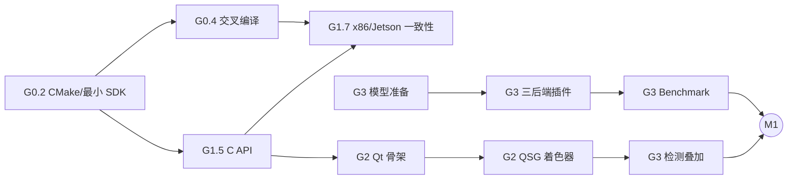

# FluxAxiom ThermalLab — 执行方案 v1.0

> 规划日期：2026-10-27
> 依据：《FluxAxiom ThermalLab 产品需求与系统架构设计 V2.0》（下称“设计文档”）；FluxAxiom《P0 阶段执行方案 v1.1》的协作方式与 2026-10-27 的仓库状态
> 性质：执行计划，**不是对设计文档 V2.0 的重新冻结**
> 目标：2027-01-17 达到 M1 投递基线；2027-02-28 达到 M2（JD 全覆盖，v1.0）；2027-03-28 发布 v1.1（Agent 集成）
> 状态：**G0 进行中；G0.2 已提交，G0.3 工作流在工作区，尚未在 GitHub 上跑过**

## 0. 修订记录

| 变更 | 位置 |
| --- | --- |
| v1.0 初稿：按 G0–G6 拆工作包，G0/G1 细到 PR 切片，G2–G6 留到阶段对齐时细化 | §4、§5 |
| 合成 Y16 Golden 样本先于 P2 Pro 实录，G1 数值路径不依赖相机到货 | §4.3 G1.1 |
| 新增 ADR-017（P2 Pro 采集后端），Windows 与 Linux/Jetson 的采集方式待 spike 后决定 | §4.3 G1.8、§8.2 |
| 能写成 CI 检查的约束集中列出，规则文字只做引导 | §6 |
| 设计文档 §5.8 的 FluxAxiom 状态已过时，按 2026-10-27 仓库重新核对 G6 前置条件 | §11 |
| NFR-02/05/06/08/09/14/15 挂到具体工作包的验收证据上 | §4、§5 |
| Windows 本机与 CI 都用 MSYS2 MinGW GCC，不使用 MSVC；预设改为 `windows-gcc-*`。许可证 MIT。MFC-01 仍待 G4 决定 | §4.2、§4.2.1、§6 |
| G0.1 文件约定：版权行 `Copyright (c) 2026 FluxAxiom ThermalLab`；clang-format 为 LLVM、列宽 100、缩进 4；LFS 跟踪 y16/onnx/engine/mp4/mov | §4.2.1 |
| G0.2：C++17；Qt LTS 留到 G0.8；`tl_get_version` 返回静态 `0.0.1`；vcpkg baseline `15b12b99` | §4.2、§4.2.1 |
| G0.3：CI 四个作业；Windows 锁定 GCC 15.2.0-8 与 clang-format 21.1.1-2；Linux 用 ubuntu-24.04 自带 GCC | §4.2.1 |

<!-- 对齐中做出的落地选择，按「Gx.y 已确定的……」写进对应小节，并在本表加一行。 -->

## 1. 成功定义与边界

### 1.1 M1：投递基线（2027-01-17）

SDK、红外处理、桌面客户端、录像、三后端推理与 Benchmark、MySQL、Python 绑定、性能报告 v1、3 分钟演示视频 v1。达到后即可开始投递与内推。

### 1.2 M2：JD 全覆盖 v1.0（2027-02-28）

在 M1 之上补齐 ThermalService、共享内存预览、Web/Android、MFC、ESP32、Qt 交叉编译到 Jetson、INT8、硬件编解码、延迟探针、安装包、故障演练、文档。设计文档第 11 章 JD 覆盖矩阵每一行有证据链接或明确的 `Blocked`。

### 1.3 v1.1：Agent 集成（2027-03-28）

FluxAxiom 只读工具、经审批的受控执行、Run 与 Experiment 对账、可追溯报告。前置条件见 §11。

### 1.4 明确不做

沿用设计文档 §1.3。另外：

- 不为“以后可能用到”建空目录、空库、空接口。目录在第一个使用它的工作包里创建。
- 不做没有对照数据的性能结论，不写“零拷贝”“实时”这类未经实测的描述。
- 作品集表述为“个人主导设计并完成的完整项目”，不包装团队规模。

## 2. 关键路径与阶段门禁

| 阶段 | 日期 | 版本 | 门禁要点（全文见设计文档 §9） |
| --- | --- | --- | --- |
| G0 基线与骨架 | 10-26 至 11-01 | `v0.0.1` | Windows/Linux CI 阻止失败合并；Jetson 运行交叉编译的 hello；硬件与许可证登记完 |
| G1 SDK | 11-02 至 11-22 | `v0.1.0` | 纯 C Demo 回放 Y16 输出 ROI 温度；x86 与 Jetson 温度差 < 0.01 °C；1,000 次循环无泄漏 |
| G2 Desktop | 11-23 至 12-20 | `v0.2.0` | QML 实时测温；着色器与 CPU 差 ≤ 1 LSB；录像与 A/V 偏移；OpenCL 与 GL 对照数据；2 小时长测 |
| G3 AI Lab | 12-21 至 01-17 | `v0.3.0` | Jetson 三后端真实推理；Benchmark 可复算；MySQL 重启可查；**M1** |
| G4 Cross-device | 01-18 至 02-14 | `v0.4.0` | `RemoteClient` 切换 QML 不改；WebRTC；ESP32 真机与模拟器；Qt 在 Jetson 运行 |
| G5 收口 | 02-15 至 02-28 | `v1.0.0` | INT8、硬编、延迟探针、安装包、故障演练、JD 矩阵；**M2** |
| G6 Agent | 03-01 至 03-28 | `v1.1.0` | 未审批不能执行；重试不重复；Run → Experiment → Artifact 贯通 |

**门禁与日历的关系**：FluxAxiom 以门禁而不是日历切换阶段。ThermalLab 有春招截止时间，所以两者都用，但分工不同：

- **门禁决定能不能声明完成。** 没有证据的项不写成通过，缺硬件的标 `Blocked`，`Blocked` 不阻塞下一阶段，但阻止对应的 JD 覆盖声明（设计文档 §9.1）。
- **日历决定什么时候砍范围。** 每阶段结束时落后，按设计文档 §9.1 的顺序砍：先 SHOULD 项，再压缩性能实验轮次；M1/M2 必测项不砍。

关键路径：



G3 的模型准备含训练等待，是唯一可能独自拖慢 M1 的任务。G2 有空档时先准备数据和训练脚本。

## 3. 仓库初始布局

目标布局见设计文档 §8.1。G0 只创建 G0 用得到的部分：

```text
FluxAxiom-ThermalLab/
├── CMakeLists.txt
├── CMakePresets.json
├── vcpkg.json
├── AGENTS.md
├── .cursor/rules/
├── cmake/                      # 警告、sanitizer、工具链
├── sdk/
│   ├── include/thermallab/     # 公共头文件
│   ├── core/                   # tl_get_version
│   └── tests/
├── examples/c-sdk/             # hello
├── deploy/docker/              # 交叉编译镜像
├── deploy/jetson/              # smoke 脚本
├── scripts/env/                # 环境采集脚本
├── assets/benchmarks/baseline.yaml
├── docs/architecture|development|adr|environment/
└── .github/workflows|ISSUE_TEMPLATE/
```

## 4. G0–G1：按 Issue / PR 执行的工作包

每项一个 Issue、一个可审查 PR；工作包过大时拆成多个小 PR，但不跨越验收定义。每个工作包下的「待对齐」是开工前要和用户一起决定的问题，决定后写进对应的「已确定的选择」小节。

### 4.1 第一周的执行建议

先做 **G0.1 → G0.2 → G0.3**，让 CI 尽早能拦住失败；G0.4 交叉编译依赖 G0.6 采到的 Jetson 版本信息，G0.6 和 G0.7 今天就开始，和代码并行。第一周不碰任何业务代码。

### 4.2 G0：基线与骨架

| ID | 产出 | 前置 | 关键验收证据 |
| --- | --- | --- | --- |
| **G0.1** | 仓库、执行包与设计文档入库；`.gitignore`、`.gitattributes`（Git LFS）、`.clang-format`、`.editorconfig`、LICENSE、README 初稿 | 无 | 首次提交在 `main`；LFS 生效；README 写明当前阶段与诚实边界 |
| **G0.2** | 根 CMake、`CMakePresets.json`、警告与 sanitizer 模块、`vcpkg.json`（只有 gtest）、`thermallab::core` 与 `tl_get_version`、GoogleTest 与 C99 头文件编译测试 | G0.1 | SDK-01 骨架。本机对应预设构建并通过 `unit`；`linux-asan` 通过；C99 编译测试通过 |
| **G0.3** | GitHub Actions：Windows MinGW GCC、Linux GCC、Linux ASan、clang-format 检查；分支保护 | G0.2 | BUILD-01、QA-01。一个故意失败的 PR 被阻止合并（截图入 `docs/evidence/G0.3/`，随后撤掉）；`main` 全绿 |
| **G0.4** | 交叉编译 Docker 镜像、sysroot 获取脚本、CMake 工具链、`jetson-cross-release` 预设、`hello`、`deploy/jetson/smoke.sh` | G0.2、G0.6 | BUILD-02 雏形。`file` 显示 aarch64；Jetson 上 hello 输出版本号；`ldd` 无缺失；rpath 为 `$ORIGIN` |
| **G0.5** | Jetson self-hosted runner；CI 增加交叉编译作业，Jetson 作业只响应 `main` 与手动触发 | G0.3、G0.4 | 手动触发成功的运行链接 |
| **G0.6** | 硬件与环境清单（设计文档 §14.1 全部条目）、三平台环境采集脚本、`baseline.yaml` 骨架 | 无 | 清单无空白项，缺失项写预计到位日期与受影响工作包；三平台环境 JSON 入库 |
| **G0.7** | `docs/third-party-licenses.md` 初版 | 无 | 设计文档 §6.5 每一行都有结论、核对日期与来源 URL，没有“待定” |
| **G0.8** | ADR-001、002、004、013、014 | G0.4、G0.6、G0.7 | 用户审阅后状态为“已采用”；ADR-013 的 JetPack/CUDA/TensorRT 为实测版本并声明周期内锁定 |

**待对齐**：

- G0.4：sysroot 从 Jetson 用 rsync 拉取，还是解包 NVIDIA 发布的 L4T rootfs？Jetson 上的测试是跑交叉编译的二进制，还是在 Jetson 本机构建？
- G0.7：MySQL 客户端库选 MariaDB Connector/C（LGPL）还是 MySQL Connector/C++（GPLv2 + FOSS Exception）？红外数据集是否允许公开发布衍生模型？检测模型选 YOLOX 还是 RT-DETR？

### 4.2.1 G0 已确定的选择

2026-10-27 已确定：

- 主开发机是 Windows，编辑器是 Cursor，不安装 Visual Studio。
- 仓库许可证是 MIT。
- Windows 本机与 CI 都用 MSYS2 MinGW GCC，不使用 MSVC，不设 `windows-msvc-*` 预设。本机实测编译器为 MSYS2 mingw64 GCC 15.2.0，生成器为 Ninja。预设名是 `windows-gcc-debug`、`windows-gcc-release`。CI 的 Windows 作业安装同一主版本的 mingw-w64 GCC，包版本在 G0.3 锁定。预设不写本机绝对路径。
- 设计文档 §5.2 仍写「Windows MSVC」。本方案这一轮改用 MinGW GCC。两者的 CRT 不同，不把 MinGW 编出的库当成 MSVC 程序可链接的证明。
- 设计文档 MFC-01 仍要求「MSVC 独立编译」。MFC 不能用 MinGW 编译。G4.10 开工前再决定：为这一个示例单独使用 MSVC，或把 MFC-01 标为 `Blocked`。G0 不为此安装 MSVC。

尚未决定，留在上面的待对齐里：Jetson 型号与 JetPack 版本、sysroot 来源。

G0.2 已确定（2026-10-28）：

- C++ 标准是 17。GCC 15 能编译 20，这一阶段仍按设计文档 §6.1。
- Qt LTS 不在 G0.2 锁定，留到 G0.8 的 ADR-013。这一阶段不写该 ADR。
- `tl_get_version` 的签名是 `const char* tl_get_version(void)`，返回静态字符串 `0.0.1`，进程结束前一直有效。不引入 `tl_status`，错误码表仍属于 G1.2。
- `cmake_minimum_required` 是 3.28。`linux-asan` 使用 `-fsanitize=address,undefined,leak` 和 `-fno-omit-frame-pointer`，只在 Linux 打开。
- 动态库目标是 `thermallab_core`，别名 `thermallab::core`，输出名 `thermallab`。
- vcpkg `builtin-baseline` 是 `15b12b99a227d51e21c86dffd40385439eac87a0`。该提交里的 gtest 端口为 1.18.0。Windows 三元组是 `x64-mingw-static`。预设通过 `VCPKG_ROOT` 找工具链，不写本机绝对路径。
- `jetson-cross-release` 仍到 G0.4 再加入。`install(EXPORT)` 仍到 G1.6。

G0.3 已确定（2026-10-28）：

- 工作流是 `.github/workflows/ci.yml`。作业名是 `windows-gcc-debug`、`linux-debug`、`linux-asan`、`clang-format`。触发是 `main` 的 push 和所有 pull request。测试只跑 `unit|golden`，并带 `--no-tests=error`，标签匹配不到任何测试时作业失败。
- Windows 作业安装 `mingw-w64-x86_64-gcc` 15.2.0-8 和 `mingw-w64-x86_64-ninja`。编译器版本必须是 15.2.0。镜像不再提供该包时作业失败，不改成浮动最新包。
- `clang-format` 作业安装 `mingw-w64-x86_64-clang` 21.1.1-2，对 `sdk/` 里的 C/C++ 头和源文件执行 `clang-format --dry-run --Werror -style=file`。
- Linux 两个作业使用 `ubuntu-24.04` 自带的 GCC 和 CMake 3.28.3，不另装 GCC 15。日志打印 `g++ --version`。
- vcpkg 只检出 baseline `15b12b99a227d51e21c86dffd40385439eac87a0`。不跑 release 预设，不加 Jetson runner。
- 本地已配置 `origin`（`SamhandsomeLee/FluxAxiom-ThermalLab`），但这一轮没有确认远程内容，工作流也没有运行记录。分支保护、故意失败的 PR、`main` 全绿都还没有证据。截图目录等证据出现再创建。失败 PR 关掉，截图留下。

G0.1 文件约定（2026-10-27）：

- `LICENSE` 版权行是 `Copyright (c) 2026 FluxAxiom ThermalLab`。
- `.clang-format` 使用 `BasedOnStyle: LLVM`、`ColumnLimit: 100`、缩进 4、`UseTab: Never`、`Standard: c++17`。这只约束排版，不表示使用 Clang 编译。C++ 标准已在 G0.2 定为 17。
- `.editorconfig`：UTF-8、LF、文件末尾换行、去掉行尾空格。C/C++ 缩进 4，YAML、JSON、Markdown 缩进 2。
- Git LFS 跟踪 `*.y16`、`*.onnx`、`*.engine`、`*.mp4`、`*.mov`。
- `.gitignore` 忽略 `build/`、`out/`、`vcpkg_installed/`、`CMakeUserPresets.json`、`compile_commands.json`、`deploy/jetson/sysroot/`。
- README 使用中文。

### 4.3 G1：SDK v0.1

设计文档 §13 的 TL-001 对应 G1.1–G1.7，是第一条纵切路径：Y16 回放 → C++ 读取 → 温度换算 → C API → C Demo → x86 与 Jetson 一致。第 2 周完成这一段，第 3–4 周补齐红外处理与健壮性。

| ID | 产出 | 前置 | 关键验收证据 |
| --- | --- | --- | --- |
| **G1.1** | `contracts/replay-format-v1.md`；合成 Y16 样本生成脚本（固定种子：已知温度的热点、移动冷点、一帧 NUC、若干坏点）与解析解 `expected.json`；`assets/samples/manifest.yaml` | G0 | SRC-01。契约状态 Frozen；脚本两次运行 SHA256 相同；对齐回复中手算一帧的 ROI 结果与 `expected.json` 一致 |
| **G1.2** | 公共类型（`tl_status` 错误码表、像素格式、帧信息、`ThermalMeta`）；内部 `Frame`、`IFrameSource` 与数据源状态机；错误码文档 | G1.1 | SDK-02。公共头文件 C99 编译通过；状态机非法迁移有测试；每个错误码写明语义与是否可重试 |
| **G1.3** | `ReplaySource` | G1.2 | SRC-01。正常读取、坏魔数、未知版本、截断最后一帧、空文件、侧车缺失、SHA256 不符、读到末尾，各有测试；两次回放帧数据哈希一致；ASan 通过 |
| **G1.4** | 温度换算 v1、矩形 ROI 的 max/min/avg 与位置；ADR-006 | G1.2 | THM-01、THM-02。合成样本全部帧与 `expected.json` 差 < 0.01 °C；发射率边界、raw 极值、NUC 帧有测试 |
| **G1.5** | 最小 C API（设计文档 §5.2 函数集）与纯 C Demo `replay_roi` | G1.3、G1.4 | SDK-01、SDK-02。Demo 输出与 `expected.json` 一致（CTest 比对）；NULL、无效句柄、重复 destroy、`size` 过小的结构体有负向测试 |
| **G1.6** | SDK 安装与 CMake config；外部消费者小项目 | G1.5 | CI 中安装后构建消费者项目（Windows、Linux） |
| **G1.7** | Jetson 交叉构建 SDK、Demo 与测试；x86 与 Jetson 输出比对脚本 | G1.5、G0.4 | BUILD-02。TL-001 的 DoD 全部满足；比对报告入 `docs/evidence/G1.7/`（NFR-04） |
| **G1.8** | P2 Pro 采集 spike + `ThermalUvcSource`；录制工具；ADR-017 | G1.5 | SRC-02。三平台各录 10 秒，日志与 SHA256 入证据目录（缺硬件标 `Blocked`）；一段 ≤ 5 MB 实录样本入 Golden；温度半帧提取有不依赖硬件的单测 |
| **G1.9** | 盲元检测与替换 | G1.3 | THM-05。合成样本注入的坏点全部检出、零误检；边角坏点与坏点簇有测试 |
| **G1.10** | AGC：线性、直方图均衡、平台直方图；输出 AGC 参数供着色器复用 | G1.3 | THM-03。合成样本与 P2 Pro 样本的 Golden 哈希一致；常数图、全 0、全 65535 有测试 |
| **G1.11** | 伪彩 LUT（≥ 6 种）与等温线的 CPU 参考实现 | G1.10 | THM-04（CPU）。每种 LUT 有 Golden；等温线判定基于温度矩阵而不是 8-bit |
| **G1.12** | 点、线、框测温与全帧高低温追踪 | G1.4 | THM-02。与解析解或手算一致；线 ROI 越界裁剪有测试 |
| **G1.13** | 报警判定引擎与 C API | G1.12 | THM-06。达到 hold 时间、阈值附近抖动（迟滞）、恢复、多规则、乱序 `pts_ns`、NUC 帧穿插各有测试 |
| **G1.14** | 健壮性：1,000 次 create/open/read/close/destroy；线程模型文档；（SHOULD）回放解析器模糊测试 | G1.5–G1.13 | ASan/LSan 零报告；Linux 上 Valgrind 日志入证据目录（NFR-10） |
| **G1.15** | ADR-003、ADR-006 定稿；Doxygen；`docs/releases/v0.1.md`；三平台 SDK 包；`v0.1.0` | 全部 | G1 验收报告（§9 模板）逐条有证据 |

**待对齐**：

- G1.1：帧头里除了 `frame_id`、`pts_ns`，还要放哪些字段（NUC 标志、相机温度）？侧车 SHA256 默认校验还是可选？
- G1.2：同一个 `tl_context` 是否允许多线程调用？不允许时，是返回 `TL_ERR_BUSY` 还是写成调用方责任？
- G1.4：**温度公式要先定，再写代码。** 候选：`T_meas = raw × scale + offset`（开尔文）；发射率与反射温度修正用总辐射近似 `T_obj⁴ = (T_meas⁴ − (1−ε)·T_refl⁴) / ε`。这个近似忽略了窄波段与大气透过率，距离、湿度参数保留在接口里但 v1 不参与计算。是否采用、误差如何标注，写进 ADR-006。NUC 帧是返回 `TL_ERR_BUSY` 还是标记“不可测温”？
- G1.8：社区参考实现描述 P2 Pro 以 UVC 输出 256×384 的 YUYV 帧，上半部分是图像，下半部分是约 1/64 K 单位的 16-bit 温度数据。**这是待实机核实的假设**：要抓原始帧，对着冰水与已知温度物体核对。采集后端的候选：Linux/Jetson 用 V4L2；Windows 用 Media Foundation（保留系统 UVC 驱动），或 libuvc + WinUSB（需用 Zadig 替换驱动，相机在其它软件里不可用）。设计文档提到的是 libuvc，选别的方案需要在 ADR-017 说明理由。
- G1.11：六种 LUT 用控制点插值自行生成，不复制厂商色表。具体是哪六种？
- G1.13：NUC 帧期间报警的持续计时是暂停还是继续？

### 4.3.1 G1 已确定的选择

（对齐后写入。）

## 5. G2–G6：工作包

G2 起只列到“产出 + 前置 + 关键验收证据”。**每个阶段开始的第一天做一次阶段对齐**：结合当时的代码，把本阶段工作包拆成 PR 切片、列出待对齐问题，写进本方案，再开始第一刀。

### 5.1 G2：Desktop v0.2（11-23 至 12-20）

| ID | 产出 | 前置 | 关键验收证据 |
| --- | --- | --- | --- |
| **G2.1** | Qt 6 应用骨架、8 个页面导航、`ThermalClient` 门面与 `InProcClient`、基础 ViewModel（UI-01、UI-02） | G1 | Qt Test 覆盖属性通知与跨线程更新；CI 安装 Qt 并构建 |
| **G2.2** | `IFrameChannel` 与 `InProcFrameChannel`；ADR-007 的共享内存布局设计（CH-01） | G2.1 | TSan 下单写多读压测零报告；读端持有的槽位不被覆盖；丢帧计数正确 |
| **G2.3** | QSG 热像节点：Y16 纹理、着色器 AGC/LUT/等温线；ADR-005（RND-01、RND-02、THM-04） | G2.2、G1.10、G1.11 | D3D11、Vulkan、OpenGL 三个后端都能显示；16-bit 纹理不可用时的退化路径可运行 |
| **G2.4** | 渲染一致性测试 | G2.3 | 各 LUT × 各后端与 CPU 参考差 ≤ 1 LSB，差分图入证据（NFR-04） |
| **G2.5** | ROI 交互、参数面板（UI-04、UI-05）与回放控制（UI-03） | G2.3、G1.12 | Qt Test 覆盖 ROI 增删改与逐帧前进；交互录屏 |
| **G2.6** | FFmpeg 文件源（SRC-03）；CI 检查 FFmpeg 配置不含 GPL | G1 | 自制 H.264 样本的帧数、PTS 单调、seek 精度 |
| **G2.7** | 录像（OpenH264 伪彩 + Y16 侧车）与辐射截图（MED-01、THM-07） | G2.6、G1.11 | `ffprobe` 可解析；侧车与视频帧数、时间戳对齐；截图重新加载后温度矩阵一致 |
| **G2.8** | 语音备注轨与 A/V 同步（MED-02） | G2.7 | 合成蜂鸣与帧标记测出的 A/V 偏移有数值和阈值 |
| **G2.9** | 可见光 UVC 源（SRC-04） | G1.8 | 实机采集录屏（缺硬件标 `Blocked`） |
| **G2.10** | CPU 图像算子与 OpenCL 加速（IMG-01、IMG-02） | G1.9–G1.11 | x86 上与 CPU 容差一致；时延对比附 `baseline_id` |
| **G2.11** | 原生 OpenGL 上传实验第一轮（RND-03） | G2.3 | `glTexSubImage2D` 与双 PBO 的 P50/P95 |
| **G2.12** | 线程边界文档与并发测试；2 小时长测；`v0.2.0`（NFR-01、NFR-07） | 全部 | TSan 零报告；RSS 线性回归斜率不显著；G2 验收报告 |

### 5.2 G3：AI Lab v0.3 = M1（12-21 至 01-17）

| ID | 产出 | 前置 | 关键验收证据 |
| --- | --- | --- | --- |
| **G3.1** | 红外检测模型准备：许可证合规模型、离线微调、ONNX 导出、模型卡（INF-07） | G0.7 | `onnx.checker` 通过；验证集 mAP；模型卡含数据来源与许可证。**第 9 周第一天启动** |
| **G3.2** | 插件 ABI、宿主加载器、模型元数据、fake 插件；ADR-008（INF-01、INF-06） | G1 | 缺失插件、ABI 不符、`size` 过小、Runtime 缺失均不崩溃并有明确错误 |
| **G3.3** | 统一前后处理：Y16 → 模型输入、letterbox、NMS（INF-05） | G3.2、G2.10 | 与 Python 参考逐框一致 |
| **G3.4** | ONNX Runtime 原生插件（INF-02） | G3.2、G3.3 | x86 与 Jetson CPU 真实推理并与参考一致 |
| **G3.5** | OpenVINO 原生插件（INF-03） | G3.2、G3.3 | 按设计文档 §6.3 能力矩阵通过，不支持的组合标 `Blocked` |
| **G3.6** | TensorRT 原生插件，Engine 本机构建与缓存键（INF-04） | G3.2、G3.3 | Jetson 真实推理；无 x86 NVIDIA GPU 时标 `Not Verified` |
| **G3.7** | 检测叠加按 `frame_id` 对齐、框内最高温（UI-06） | G3.4、G2.3 | 错位帧不叠加的测试；录屏 |
| **G3.8** | `ResourceArbiter`；ADR-009（RES-01） | G3.2 | 独占时共享请求排队；超时回收；TSan |
| **G3.9** | Benchmark Runner 与 JSON/CSV/Markdown 报告（BEN-01、BEN-02） | G3.4–G3.8 | 同配置两次运行可从原始样本复算 P50/P95（NFR-08） |
| **G3.10** | ThermalService 骨架：健康检查、实验 API、`ExperimentJob` 状态机、幂等键（SVC-01） | G3.9 | 状态机合法与非法迁移；重复幂等键返回同一 `experiment_id`；取消落到 `Succeeded` 的竞态；日志带 `trace_id`（NFR-09） |
| **G3.11** | MySQL 迁移、Repository、文件存储；ADR-010（DB-01、DB-02） | G3.10 | CI 容器中集成测试；重启后历史可查；迁移可重复执行 |
| **G3.12** | 实验面板、性能面板、报警规则与告警列表（UI-07、UI-08、UI-09） | G3.10、G1.13 | Qt Test；常规操作响应 P95 < 200 ms 有测量（NFR-02） |
| **G3.13** | pybind11 绑定、pytest、分析脚本（PY-01） | G1、G3.9 | pytest 与 C Demo 结果一致；报告可由脚本复现 |
| **G3.14** | 一次性能瓶颈定位与 A/B（QA-01） | G3.7、G3.9 | 问题、证据、改动、前后数据 |
| **G3.15** | M1 材料：性能报告 v1、演示视频 v1、简历描述；`v0.3.0` | 全部 | G3 验收报告；**M1** |
| 并行 | 设备协议 v1 规格与 `device-sim`（即 G4.5，提前做） | 无 | 见 G4.5 |

### 5.3 G4：Cross-device v0.4（01-18 至 02-14）

最拥挤的阶段，春节（02-06）前后约 02-05 至 02-13 按半产能计。Web/Android 以 AI 按 OpenAPI 生成为主，MFC 控制在 2 天内。

| ID | 产出 | 前置 | 关键验收证据 |
| --- | --- | --- | --- |
| **G4.1** | OpenAPI 冻结、契约测试、TS/Kotlin 客户端生成（SVC-02） | G3.10 | 契约测试覆盖正常、错误、版本不兼容 |
| **G4.2** | 鉴权与配对、HTTPS、路径白名单；ADR-011（SVC-03） | G4.1 | 无 execute 权限的写请求被拒；路径穿越被拒（NFR-12） |
| **G4.3** | `ShmFrameChannel`、`RemoteClient`、ThermalService 接管设备（CH-02） | G2.2、G4.1 | 切换后 QML 与 ViewModel 的 diff 为空；预览满足 NFR-03；读端被杀后写端不受影响 |
| **G4.4** | MediaMTX 推流、WHEP、WebSocket 叠加（MED-03） | G2.7、G4.3 | 浏览器播放；分段时延表（NFR-06，G5 用探针补实测） |
| **G4.5** | 设备协议 v1 规格、纯 C 编解码库、`device-sim`；ADR-012（EMB-02） | 无 | 编解码单测；模拟器支持丢包、错 CRC、延迟、乱序、重启注入 |
| **G4.6** | `IDeviceLink` 三个实现、连接状态机、报警联动与重连对账 | G4.5、G1.13 | 模拟器上的全部故障注入测试在 CI 通过；真机串口超温到 ACK 的 P95 < 300 ms（NFR-05） |
| **G4.7** | ESP32 FreeRTOS 固件（EMB-01） | G4.5 | 真机日志：握手、心跳、报警、拔线重连；栈水位报告 |
| **G4.8** | Web 端（WEB-01、AI-DEV-01） | G4.1、G4.2、G4.4 | Vitest + Playwright；PR 的 AI 协作记录 |
| **G4.9** | Android 端（AND-01、AI-DEV-01） | G4.1、G4.2、G4.4 | 真机录屏；契约测试；AI 协作记录 |
| **G4.10** | MFC 示例（MFC-01） | G1.15 | Windows 运行截图；调试堆无泄漏 |
| **G4.11** | Qt 交叉编译到 Jetson 并运行（BUILD-03、UI-10） | G0.4、G2 | Jetson 上运行录屏与日志，只有构建产物不算 |
| **G4.12** | AI 跨端开发记录汇总；`v0.4.0` | G4.8、G4.9 | G4 验收报告 |

### 5.4 G5：收口 v1.0 = M2（02-15 至 02-28）

不新增功能。

| ID | 产出 | 前置 | 关键验收证据 |
| --- | --- | --- | --- |
| **G5.1** | FP32 / FP16 / INT8 对比（BEN-03） | G3.6、G3.9 | 校准集 SHA256；精度变化；附 `baseline_id` |
| **G5.2** | 硬件编解码 A/B（MED-04） | G2.7 | 至少一个平台的数据；Orin Nano 无硬件编码器时在 x86 做 |
| **G5.3** | 延迟探针实测（EMB-03） | G4.7、G2.9 | N ≥ 100 次的屏到屏分布；热像链路分段打点；写明测量边界 |
| **G5.4** | 图形后端帧时间对照收尾（RND-03） | G2.11 | D3D11 / Vulkan / OpenGL 与 Jetson GLES 数据 |
| **G5.5** | 三平台安装包与 SDK 包（BUILD-04、NFR-13） | G4 | 安装、启动、卸载测试日志 |
| **G5.6** | 故障演练与 Jetson 2 小时长测（NFR-01、NFR-07、NFR-11） | G4 | 杀服务、拔 ESP32、断网、拔相机各自的预期与实际状态 |
| **G5.7** | README、Doxygen、ADR 状态、JD 覆盖矩阵、《AI 跨端开发复盘》、兼容性测试与风险分析（NFR-14、NFR-15） | 全部 | 矩阵无空行；用 v0.1 头文件编译的消费者能链接 v1.0 库 |
| **G5.8** | 发布 `v1.0.0` | G5.1–G5.7 | 设计文档 §10.1 八项材料；G5 验收报告；**M2** |
| **G5.9** | SHOULD 项（按价值）：BEN-04 功耗档位对照、UI-11 双路查看、EMB-04 温湿度补偿或云台、THM-08 两点校正 | 对应模块 | 做了的有证据；没做的写进已知限制 |

### 5.5 G6：Agent v1.1（03-01 至 03-28）

| ID | 产出 | 前置 | 关键验收证据 |
| --- | --- | --- | --- |
| **G6.1** | 只读 Tool Adapter（AGT-01），API 稳定后可提前到 G4/G5 空档 | G4.1 | Fake LLM E2E：Agent 读到的指标可由原始样本复算 |
| **G6.2** | 有副作用工具与审批（AGT-02）；ADR-015 | G6.1、§11 前置 | 未审批被拒；超时重试不产生重复实验；服务端二次校验令牌 |
| **G6.3** | Run ↔ Experiment 映射与对账；ADR-016 | G6.2 | `Unknown` 最终可对账；`RunId → ExperimentId → ResultArtifact` 贯通 |
| **G6.4** | 可追溯报告（AGT-03） | G6.3 | 每条结论有来源引用 |
| **G6.5** | 故障演练与 `v1.1.0` | G6.1–G6.4 | 杀 Agent、杀服务、断网、预算耗尽不虚报；FluxAxiom 关闭时桌面独立完成测温与 AI |

## 6. 机械检查：能自动拦住的不靠规则文字

规则文件只能引导，能写成检查的约束放进 CI 或 hook。以下检查在对应工作包里落地，落地后可以从 `.cursor/rules/` 里删掉相应的文字。

| 检查 | 拦住什么 | 落地 |
| --- | --- | --- |
| `-Werror`、clang-format | 警告与格式漂移 | G0.2、G0.3 |
| C99 编译全部公共头文件 | C++ 类型、`bool`、命名空间混进公共 ABI | G0.2 |
| ASan / UBSan / LSan 预设 | 泄漏、越界、未定义行为 | G0.2 起 |
| TSan 预设 | 数据竞争 | G2.2 起 |
| `vcpkg.json` 与模型、数据集的许可证白名单脚本 | GPL / AGPL 依赖 | G0.7 |
| `avcodec_configuration()` 检查 | GPL 配置的 FFmpeg | G2.6 |
| 契约 diff 检查：Frozen 文件的改动必须伴随版本号或变更记录 | 悄悄改契约 | G1.1 |
| Golden manifest 校验：每个样本有 SHA256 与来源，期望值改动需要提交正文说明 | 改期望值让测试通过 | G1.1 |
| grep 检查：QML / ViewModel 不 include SDK 内部头文件 | 分层被打穿 | G2.1 |
| CTest 标签检查：未标 `hardware` / `jetson` 的测试不得打开设备 | CI 依赖硬件 | G1.8 |
| 导出符号检查（`nm` / `dumpbin`）：只导出 `tl_` 前缀 | 内部符号泄进 ABI | G1.6 |

**执行与核对分权**：每个 PR 合并前，另开一个 Cursor 对话（可以换一个模型），只给 diff、`boundaries.mdc` 和执行方案里相关的原文，让它独立核对。实现时的对话不做自己的审查者。

## 7. 验收测试矩阵

沿用设计文档第 10 章。CTest 标签约定：

| 标签 | 运行位置 |
| --- | --- |
| `unit`、`golden` | GitHub 托管 runner（Windows、Linux），每个 PR |
| `jetson` | Jetson self-hosted runner，`main` 与手动触发 |
| `hardware` | 本机真机，结果入 `docs/evidence/` |
| `slow` | 手动触发的长测 |

## 8. 工作节奏

- 同时保持 **1 个主实现 Issue + 1 个并行研究/验收任务**。本周的并行任务是 FluxAxiom 的 G-A 使用观察期（§11）。
- 每个 PR 围绕一个可运行闭环，不为了目录规划创建空抽象。
- 一次只冻结下一个工作包直接依赖的接口。
- 每周日短评审：本周能演示什么、失败最多在哪里、下周是否必须做、哪些假设被否证、是否需要按 §2 砍范围。

### 8.1 G0–G1 的 Issue 标题（可直接复制）

| 顺序 | Issue 标题 | 标签 |
| --- | --- | --- |
| 1 | `G0/G0.1 Bootstrap repository, execution kit and design baseline` | `phase:g0`, `area:build` |
| 2 | `G0/G0.2 Add CMake presets, vcpkg manifest and minimal SDK target` | `phase:g0`, `area:sdk` |
| 3 | `G0/G0.3 Gate merges on Windows and Linux CI` | `phase:g0`, `area:build` |
| 4 | `G0/G0.4 Cross-compile SDK for Jetson Orin and run hello on target` | `phase:g0`, `area:build` |
| 5 | `G0/G0.5 Register Jetson self-hosted runner` | `phase:g0`, `area:build` |
| 6 | `G0/G0.6 Record hardware inventory and environment baseline` | `phase:g0`, `type:experiment` |
| 7 | `G0/G0.7 Audit third-party licenses for code, models and datasets` | `phase:g0`, `area:build` |
| 8 | `G0/G0.8 Draft ADR-001/002/004/013/014` | `phase:g0`, `area:docs` |
| 9 | `G1/G1.1 Freeze replay-format-v1 and generate synthetic Y16 golden samples` | `phase:g1`, `area:thermal` |
| 10 | `G1/G1.2 Define public status codes, frame types and source state machine` | `phase:g1`, `area:sdk` |
| 11 | `G1/G1.3 Read Y16 recordings with ReplaySource` | `phase:g1`, `area:sdk` |
| 12 | `G1/G1.4 Convert raw to temperature and measure rectangle ROI (ADR-006)` | `phase:g1`, `area:thermal` |
| 13 | `G1/G1.5 Expose minimal C API and pure C replay demo` | `phase:g1`, `area:sdk` |
| 14 | `G1/G1.6 Install SDK as CMake package and test an external consumer` | `phase:g1`, `area:build` |
| 15 | `G1/G1.7 Prove x86 and Jetson temperature results match` | `phase:g1`, `area:sdk` |
| 16 | `G1/G1.8 Capture P2 Pro raw frames on three platforms (ADR-017)` | `phase:g1`, `type:experiment` |
| 17 | `G1/G1.9–G1.11 Bad pixels, AGC modes, palettes and isotherms` | `phase:g1`, `area:thermal` |
| 18 | `G1/G1.12–G1.13 Point/line/rect measurement and alarm engine` | `phase:g1`, `area:thermal` |
| 19 | `G1/G1.14–G1.15 Robustness, docs and v0.1 release` | `phase:g1`, `area:sdk` |

### 8.2 ADR 清单

| ADR | 内容 | 时机 |
| --- | --- | --- |
| ADR-001 | C++ / Rust 分界 | G0.8 |
| ADR-002 | 设备所有者与进程演进 | G0.8 |
| ADR-003 | 帧队列背压与丢帧 | G1.15 |
| ADR-004 | SDK ABI、所有权、版本 | G0.8 起草，G1.5 定稿 |
| ADR-005 | 渲染路线与 Y16 纹理格式 | G2.3 |
| ADR-006 | 红外数据保真与温度公式 | G1.4 |
| ADR-007 | `IFrameChannel` 共享内存布局 | G2.2 设计，G4.3 实现 |
| ADR-008 | 推理插件 ABI 与三后端一致性 | G3.2 |
| ADR-009 | 资源仲裁与 Benchmark 隔离 | G3.8 |
| ADR-010 | MySQL、文件、Agent SQLite 的数据归属 | G3.11 |
| ADR-011 | 控制协议、鉴权与远程视频 | G4.2 |
| ADR-012 | 设备协议与模拟器 | G4.5 |
| ADR-013 | Jetson 环境与交叉编译 | G0.8 |
| ADR-014 | 许可证与依赖选择 | G0.8 |
| ADR-015 | FluxAxiom effect 与审批策略 | G6.2 |
| ADR-016 | 故障恢复与未知执行结果 | G6.3 |
| ADR-017 | P2 Pro 采集后端（新增） | G1.8 |

未触发新的跨模块决策时不增加 ADR 数量。

## 9. 阶段验收报告

每个阶段结束时写 `docs/development/Gx 验收报告.md`，格式参照 FluxAxiom 的《G-A 验收报告》：

- 状态一行写清：通过 / 补证中 / 哪些项待确认。
- 依据：本方案与设计文档的章节。
- 源码基线：分支与提交哈希。之后的修复不回填旧提交的证明范围。
- 验收卡逐条：结果与证据（命令、输出摘要、文件链接、运行链接）。
- `Blocked` / `Not Verified` 单列，写原因与补证条件。
- 本阶段新增可声明的 JD 覆盖项。

## 10. 风险与退出策略

| 风险 | 处理 |
| --- | --- |
| P2 Pro 未到或数据布局与假设不同 | G1 数值路径用合成样本；G1.8 实机核实，结论入 ADR-017 |
| Windows 采集需替换驱动 | 优先 Media Foundation，保留系统驱动 |
| 温度公式没有依据 | 先写 ADR-006 再实现；不承诺计量级精度，文档标误差来源 |
| 交叉编译 glibc 不匹配 | 第 1 周就在真机验证；工具链链接 sysroot 的 glibc |
| 数据集不允许发布衍生模型 | G0.7 核对；不允许则用自采数据 |
| Jetson 型号为 Orin Nano | 无硬件编码器，MED-04 改在 x86 做 |
| G4 过载 | G4.5 提前到 G3 空档；Web/Android 以生成为主；先砍 SHOULD |
| Qt 交叉编译耗时 | 备选：在 Jetson 本机构建 Qt，写进 ADR-013 |
| 两个项目并行导致两边都慢 | 1 主 + 1 并行；FluxAxiom P0b 只用 ThermalLab 的缓冲时间推进；G6 准备好只读降级方案（§11） |
| AI 生成代码使源码认知失控 | 每个 PR 保留对齐原文、测试证据与人工确认；执行与核对分权（§6） |

## 11. 与 FluxAxiom 的衔接（2026-10-27 核对）

设计文档 §5.8 的表格写于 10-24，有两处已过时。按 `SamhandsomeLee/FluxAxiom` 的 `main`（最新提交 `2aed418`）与《P0 阶段执行方案 v1.1》§12 重新核对：

| 组件 | 设计文档 §5.8 | 2026-10-27 实际 | 对 ThermalLab 的影响 |
| --- | --- | --- | --- |
| `apps/cli` | 仅打印名称 | `run / status / events / artifacts / trace / sample` 已实现（A3–A4b） | G6 可直接用 CLI 驱动 Run，不需等待 |
| `propose_effect` | P0a 返回 `Unsupported` | 仍为 `Unsupported`；Effect Gateway 是 P0b 的 B3，**G-A 通过后才启动** | G6.2 的硬前置 |
| A5 / G-A | 未提及 | A5 安全证据补强中；G-A 验收报告 10-27 开始；5 个使用日 ≥ 10 次的观察期未开始 | 本周与 ThermalLab G0 并行 |
| P0b 沙箱 | 未提及 | B3 之前要先写 OS 专项 ADR | 影响 B3 开工时间 |

**G6.2 的前置条件**：FluxAxiom G-A 通过；B3-01（Effect 契约与状态机）、B3-02（Host Effect Ledger）、B3-03（Approval once）、B4-01 / B4-02（Unknown 与对账）完成。

**需要在 FluxAxiom 那边补的一个缺口**：P0b 计划里的 Effect 执行器是 `write_file` / `apply_patch`（B3-04）。ThermalLab 需要的副作用是“带幂等键调用 ThermalService 的 HTTP API”。这是另一类执行器：它不写本机文件，不需要 OS 沙箱，但需要 `Unknown` 状态下按幂等键查询对账。建议在 FluxAxiom 开一个 ADR 定义“外部 API 调用型 Effect”，否则 G6.2 没有落点。

**降级方案**：03-01 时 B3/B4 未就绪，G6 只做 G6.1（只读工具）和基于只读数据的 G6.4 报告，G6.2 / G6.3 推迟，在发布说明里如实写明。v1.0 的 JD 覆盖不受影响。

## 12. 当前执行顺序（2026-10-27）

**本周（G0）**：

1. 今天：G0.1 建仓库、放执行包；G0.6 先确认两件事——Jetson 型号与 JetPack 版本、P2 Pro 是否到手。
2. G0.2 → G0.3：CMake 与 CI，让失败的 PR 合不进去。
3. G0.6 采到 Jetson 版本后做 G0.4，再做 G0.5。
4. G0.7 许可证核对与代码并行，周末前完成。
5. G0.8 五份 ADR；周日写 G0 验收报告，更新 `scope.mdc` 到 G1。

**并行任务**：FluxAxiom G-A 的使用观察期（5 个使用日、≥ 10 次真实分析任务）。可以直接拿 ThermalLab 仓库当分析对象，顺便检验 FluxAxiom 对 C++ / CMake 仓库的分析质量。

**下周（G1 第 2 周）**：G1.1–G1.7，即 TL-001 纵切路径。

## 附录 A：常用开场

**开一刀**

```text
对齐 G1.3。按 pairing 规则：读执行方案 §4.3 的 G1.3 与待对齐问题、设计文档 §8.3、contracts/replay-format-v1.md，
给出改动清单、原文引用、文档没写的、我的意见。先不写代码。
```

**阶段对齐**（每阶段第一天）

```text
进入 G2。读执行方案 §5.1、设计文档对应章节和当前代码，把 G2 的工作包拆成 PR 切片，
每个切片写产出、前置、关键验收证据和待对齐问题，按 §4.3 的格式写进执行方案。
指出 G2 工作包里你认为不合理、缺失或过大的地方。
```

**独立审查**（新对话，可换模型）

```text
你只做审查，不改代码。审查对象是当前分支相对 main 的 diff。
依据：.cursor/rules/boundaries.mdc、.cursor/rules/review-sweep.mdc、执行方案中 <工作包 ID> 的验收证据。
逐条列出：违反边界的地方、验收证据缺失的地方、review-sweep 第 3 节里的同类问题。没有发现就写「未发现」，并写明核对了哪些文件。
```

**阶段验收**

```text
写 G1 验收报告。按执行方案 §9 的格式，逐条对照设计文档 §9 G1 的门禁与本方案 §4.3 的验收证据，
每条给出结果和证据。没有证据的不写通过。
```
